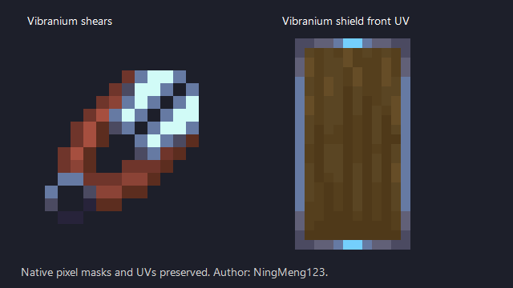

# 振金补全材质

开发者：NingMeng123

原生振金工具、盔甲、穿戴层和工作站纹理按固定上游提交逐字节导入，来源见 `../vibranium-source.md`。本文件记录上游没有提供的振金剪刀和盾牌的绘制过程；简易刀剑的十五种振金纹理由其兼容资源生成器使用同一调色板。

调色板使用内置 ImageGen 生成，原始输出为 `C:/Users/21577/.codex/generated_images/01a14ae7-bf3d-77c3-9e79-145f2fafa175/exec-4fd0609c-b860-4a96-af01-04f9704aedd7.png`，已保存到仓库的 `vibranium-palette.png`。参考输入 `build/reports/vibranium-reference/club-preview.png` 来自附件的振金棍棒第一帧；透明填充中的青绿色不参与金属取色。

最终采样的七档 RGB 为 `39,35,58`、`61,48,85`、`75,74,97`、`97,96,119`、`102,122,163`、`116,207,253`、`209,251,247`，从暗紫阴影到冷青白高光排序。

以下为内置生成工具使用的完整提示词：

```text
Use case: stylized-concept. Asset type: Minecraft vibranium weapon material palette reference for production pixel-art textures. Create a single square material study image. Match the attached vibranium club's opaque metal: deep navy-violet shadows, muted steel violet main faces, icy pale cyan specular blade edges. Ignore the pure turquoise areas of the attached preview: those are transparent sprite padding, not metal. Main output should be seven large flat solid square color swatches in one horizontal row across the middle, strictly darkest to brightest, with no outlines, each equal size, centered on a charcoal background. Target swatch colors close to #24223b, #3c3056, #4a4a62, #5f5f76, #6e7c9e, #77cefb, #d3f9f7, keep recognizable steel violet rather than green. Below the swatch row add a single small crisp Minecraft pixel-art longsword concept using only those seven shades and a dark brown grip; icy cyan edge with small restrained cyan rune accents in purple steel. No text, no labels, no gradients within flat swatches, no glow outside the weapon silhouette, no 3D rendering, no watermark. The image is a material palette reference; final game sprites preserve established original source weapon silhouettes and UVs.
```

`tools/assets/generate_vibranium_extension_textures.ps1` 使用 PowerShell / System.Drawing 将生成调色板规范化到原始像素模板，与现有 `normalize_shield_textures.ps1` 的原始 UV 保留方式一致。剪刀以现有铁剪刀为模板，选择与金剪刀不同的灰色金属像素，保持棕色握柄和全部透明度。盾牌以现代原版 `shield_base_nopattern.png` 为模板，只替换灰色金属边框，保持木板、握柄、黑色 UV 区域和透明度。按原始灰阶亮度顺序映射到七档色彩，最终游戏贴图分别为 16×16 和 64×64，不缩放 UV。

```powershell
./tools/assets/generate_vibranium_extension_textures.ps1
python tools/testing/verify_vibranium_resources.py
```

输出：`src/main/resources/assets/mite/textures/item/vibranium_shears.png` 和 `src/main/resources/assets/mite/textures/entity/shield/vibranium.png`。逐图 SHA-256、模板路径、调色板来源、尺寸和像素检查保存在 `src/main/resources/mite/vibranium-extension-assets.json`。剪刀替换 40 个金属像素，盾牌替换 284 个；两者非金属像素及 alpha 改动均为零。

下面是最近邻放大的剪刀图标及盾牌正面 UV 预览，不是游戏截图。


