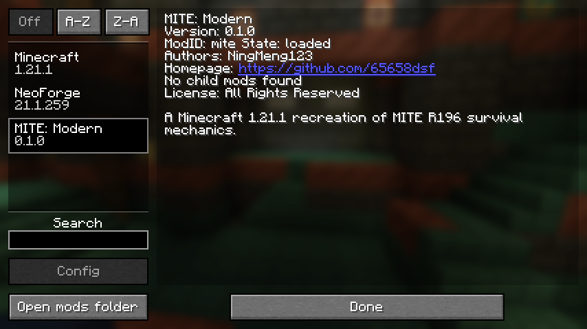
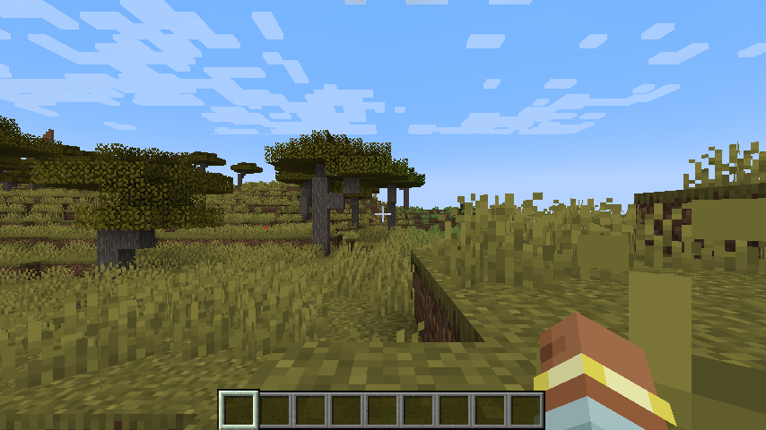

# 001：NeoForge 工程启动与存档重进

测试与开发：NingMeng123。日期：2026-10-12，Asia/Shanghai。

## 范围

验证项目构建、客户端加载、模组元数据、新建现代主世界和保存重进。本记录不代表 MITE 生存玩法或独立服务器验证已完成。

## 环境与自动检查

- Minecraft 1.21.1 / NeoForge 21.1.259 / MITE: Modern 0.1.0。
- Java 21，Gradle wrapper 9.2.1。
- `gradlew.bat compileJava`、`prepareClientRun`、`build` 均成功。
- 此时 Java 测试任务为 `NO-SOURCE`，没有将其计为已通过的功能测试。

## 游戏内操作与结果

| 操作 | 期望 | 实际 |
| --- | --- | --- |
| 启动 `runClient` | 进入主菜单 | 通过，无加载错误 |
| 打开 Mods，选择 MITE | 模组已加载，作者正确 | 显示 `mite`、`0.1.0`、`NingMeng123` |
| 进入新建 `New World` 测试存档 | 使用现代主世界，正常渲染 | 通过，进入草原/稀树草原地形 |
| 保存并返回主菜单 | 玩家和维度数据正常保存 | 日志确认三个原版维度全部保存 |
| 从存档列表再次进入 | 回到原位置，世界正常显示 | 通过，位置仍为 `(22.5, 67.0, 7.5)` |

测试存档为创造模式，启用命令，专用于后续规则验证；不是公开生存规则的默认配置。

## 证据

本地完整日志位于被忽略的 `run/logs/latest.log`。检查中未发现 ERROR 或崩溃；启动包含原版资源声音/着色器警告，未影响上述场景。

## 结论

基础工程客户端场景通过，可以提交。玩法逻辑、专服和完整成长流程仍需独立实现及验收。
