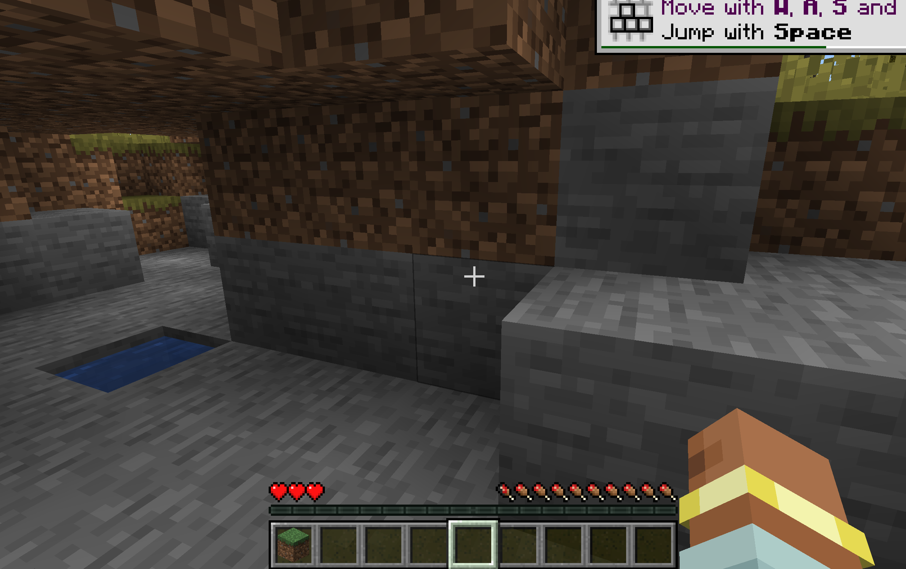
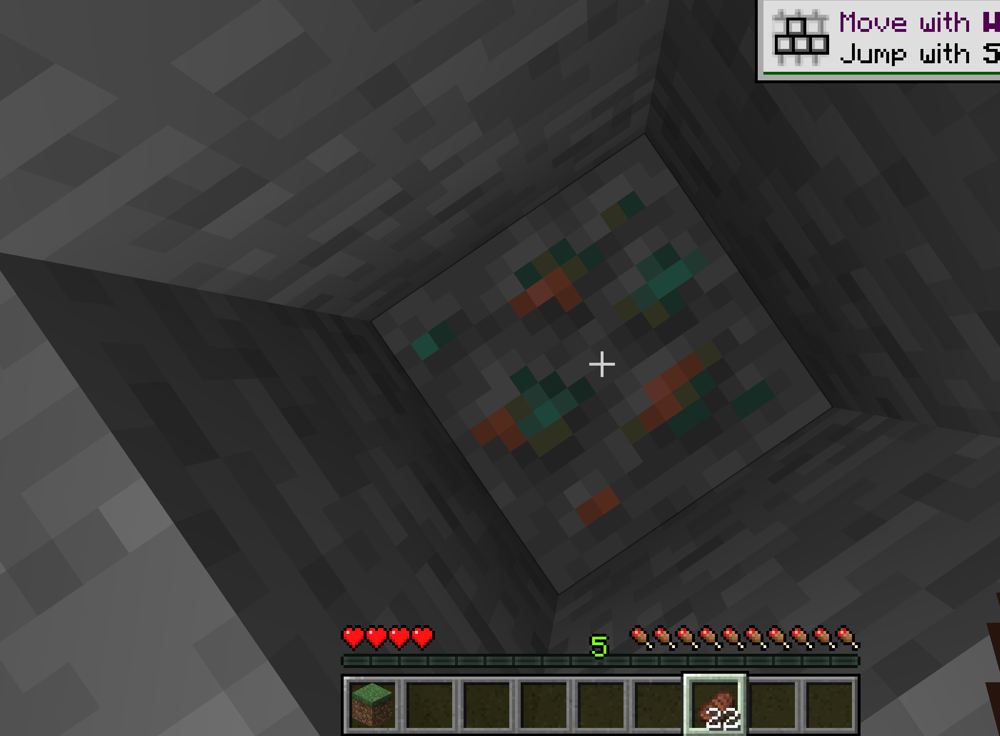

# 002：等级生命上限

开发与记录：NingMeng123。日期：2026-10-12。

功能：按照 R196 的 `clamp(6+(level/5)*2,6,20)` 设置玩家基础最大生命。当前使用 1.21.1 经验等级；R196 总经验曲线、负等级和死亡经验规则尚未实现。保留属性修饰符，升级不主动治疗，超过降低后的有效上限才钳制当前生命。

## 已完成验证

- Java 21、NeoForge 21.1.259：`gradlew.bat build` 成功，28 个 JUnit 等级边界用例通过。
- 已实际启动开发客户端，模组正常加载并进入单人测试世界。
- 用户在游戏中确认“生命值现在正常了”，提供两张截图：0 级显示 3 颗心，5 级显示 4 颗心。以下截图来自本次用户实测。

## 测试环境与边界

客户端启动曾出现 NeoForge 提前加载窗口交接超时；仅在被忽略的开发目录 `run/config/fml.toml` 设置 `earlyWindowControl=false` 后正常启动，未修改模组发布配置。测试版本为基础工程提交 `0cd6026` 加本功能工作树。

本记录未声称已完成专服、死亡重生、所有药水修饰符及跨维度实机验证。饥饿条尚未随等级改变，用户已指出，作为下一个独立功能处理。`tools/testing/create_health_smoke_pack.py` 是可选开发测试辅助，前一轮操作被 Esc 中止，不能将其预期输出算作已通过结果。
