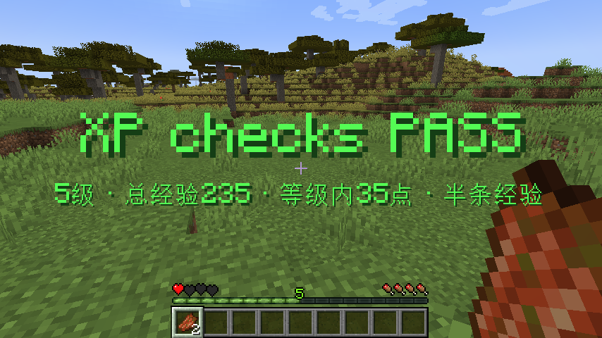
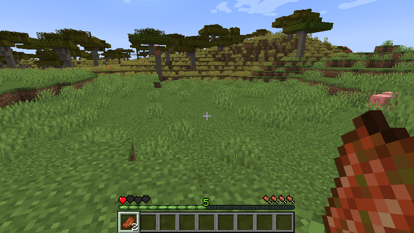

# 004：R196 正等级经验曲线

开发与记录：NingMeng123。日期：2026-10-12。

## 功能与依据

正等级累计经验为 `T(L)=5L²+15L`，升级所需经验为 `20+10L`。原始 `uf.class` 静态初始化字节码先累加初始增量 20，再将增量加 10；此前 CFR 结果把顺序错误地折叠为先加增量，已修正规则文档与 JSON。核验来源及类校验值见 [R196 玩家规则](../r196-player-rules.md)。

本次范围为 0–200 级。经验球、命令、附魔/铁砧使用的扣级入口同步维护总数、等级和经验条；查询级内点数直接使用整数，避免 8 级 53 点被浮点反算成 52。旧开发存档保留等级和经验条比例，带 `mite_experience_version=1` 的存档以总经验为准恢复。

200 级时封顶 203000 点、经验条为 0，是明确的现代安全适配。完整行为和事件语义见 [经验适配说明](../experience-adaptation.md)。

## 自动验证

在 `6832b32` 之后的本功能工作树执行 `gradlew.bat build runGameTestServer --console=plain`，2026-10-12 16:23 构建成功：

- JUnit 共 105 项通过：新增经验 77 项、既有生命/食物 28 项。经验期望值含独立的 201 项原始阈值表、负数数学边界、整数极值。
- GameTest 共 11 组通过：新增经验 8 组、既有食物 3 组。实际日志为 `All 11 required tests passed`。
- 经验 GameTest 覆盖 19/20/49/50 边界、一次跨 35 级、设置与比例扣级、实际附魔入口、NBT 挂钩、事件取消、整数极值、实际经验球拾取、命令查询和非法设置。
- 死亡复制、保留背包及客户端同步路径另做源码审查；这些不计为多人或完整死亡流程的实测。

## 真实客户端验证

启动 Minecraft 1.21.1 / NeoForge 21.1.259 开发客户端：

```powershell
python tools/testing/create_experience_smoke_pack.py "run/saves/MITE XP Test-004" --auto-start-once
.\gradlew.bat runClient "-PmiteTestWorld=MITE XP Test-004" --console=plain
```

测试世界由关闭后的 `New World` 复制为 `MITE XP Test-004`。数据包仅安装到副本，由真实玩家进入后自动运行一次，采用和平难度并关闭自然回血，保持位置和物品。数据包不随模组分发；该模式会改变测试角色经验与部分游戏规则，只用于独立测试世界。

2026-10-12 16:24:29，真实客户端接收并记录全部 15 阶段、59 项断言，汇总为 `MITE_XP stages=15 assertions=59 failures=0`。

| 检查 | 实际结果 |
| --- | --- |
| 连续添加到总经验 19、20、49、50、200 | 等级依次为 0、1、1、2、5；级内点数正确 |
| 8 级设置 53 点，再加 2 级、减 3 级 | 总经验依次 493、713、397；级内点数 53、63、47 |
| 极大负经验、一次奖励 6650、极大正经验 | 分别为 0 级、35 级、200 级，无溢出 |
| 设置 201 级、在 200 级设置 1 点 | 命令报告失败，原状态保留 |
| 生命/食物容量与等级 | 5 级基础生命 8、35/200 级为 20；当前食物不超过对应容量 |
| 最终 HUD | 5 级、半条经验，显示 4 颗心和 4 格饥饿条容量 |



随后通过游戏菜单保存退出，16:25:06 日志确认玩家和所有维度保存完成。直接只读解析保存的玩家 NBT，得到 `XpLevel=5`、`XpTotal=235`、`XpP=0.5`、`mite_experience_version=1`，并包含一次性测试完成标记。

16:25:54 重新进入同一副本，自动测试没有再次运行；实际画面仍为 5 级、半条经验。16:26:13 用游戏内 F2 保存重进证据。



## 范围与后续验收

本次未启用 R196 死亡扣经验及负等级；当前死亡与保留背包规则仍沿用新版。附魔/铁砧界面操作、修补装备、多玩家并发和跨维度仍需要专项实测，不能由本次 GameTest 推断已完成。

客户端首次退出世界时记录一条 OpenAL 音源分配错误；后续保存和重进均成功，没有经验异常或崩溃。本次没有进行音频专项验证。

对应中文提交：`复刻R196正等级经验曲线并通过实机与存档验证`。
