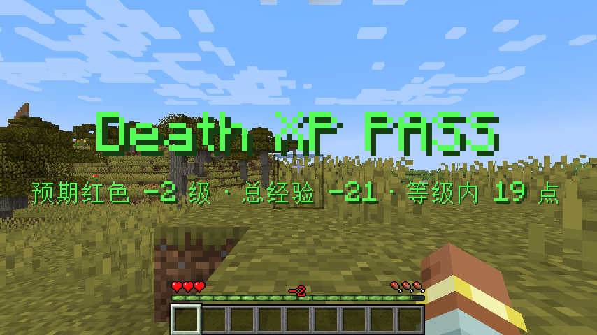
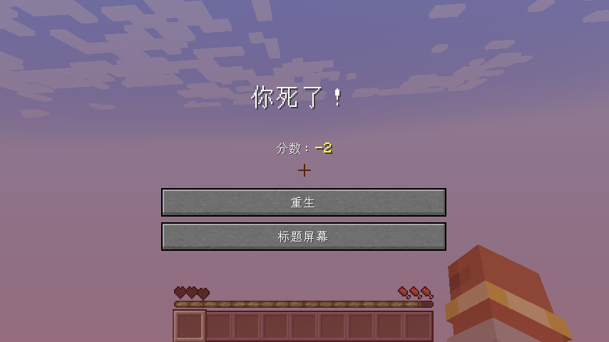
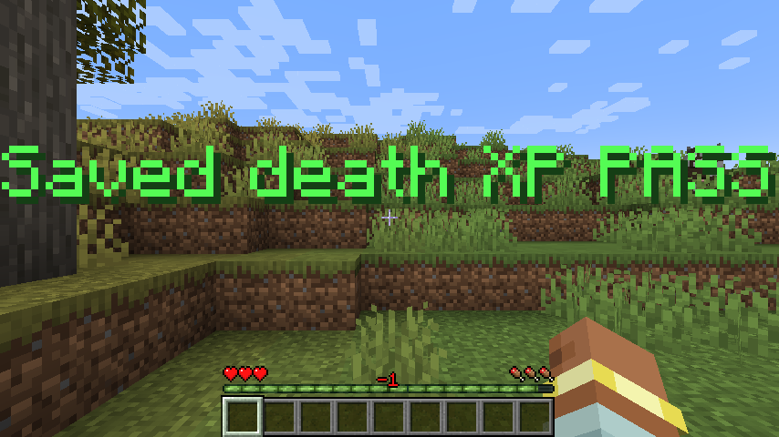
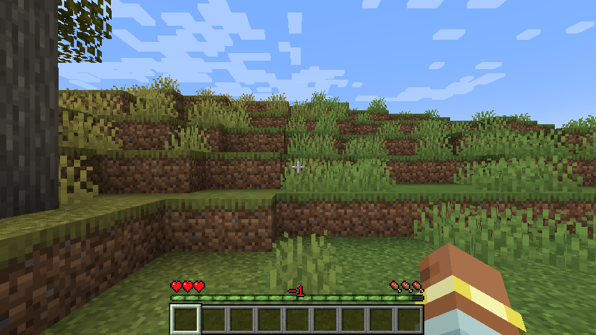

# 005：死亡经验惩罚与负等级

开发与记录：NingMeng123。日期：2026-10-12。

## 实现范围

在 `c33f3e5` 后的工作树实现 R196 死亡经验规则、有符号经验、负等级 HUD 及死亡掉落点数。原始字节码证据见 [玩家规则](../r196-player-rules.md)，现代选择见 [经验适配](../experience-adaptation.md)。

- 普通死亡前经验 `<20` 时，重生为 `max(XP-20,-800)`；经验 `>=20` 时重生为 0。保留背包、旁观和非死亡复制保留经验。
- 有符号经验范围 −800–203000，等级 −40–200。负等级保持 3 颗心和 3 格饥饿容量，等级数字用原作红色 `#FF1313`，经验条使用新版绿色材质。
- 死亡时保存版本化的 Data Attachment，正式重生应用一次并清理。死亡界面保存重进保留待处理值，取消死亡不创建惩罚。
- 存档经验版本升为 2，版本 1 的整数总数直接沿用。修复总经验 −1 与原版同步脏标碰撞，以及附魔后的原版负等级清零分支。
- 死亡经验掉落量为正累计经验的三分之一，截断取整，无 100 点上限。关闭 doMobLoot、保留背包及旁观者不掉经验；负经验不生成球。

## 自动验证

执行 `gradlew.bat build runGameTestServer --console=plain`。2026-10-12 16:45:42 日志确认 `All 21 required tests passed`，构建正常结束。

| 验证 | 结果与覆盖 |
| --- | --- |
| JUnit 122 项 | 原经验 77、容量 28、新增死亡边界 17，全部通过 |
| 经验 GameTest 9 组 | 正负边界、版本 1/2 兼容、命令、比例换级、事件取消、各模式同一经验、创造附魔不会清除负经验 |
| 死亡 GameTest 9 组 | 真正 kill 和复活请求、连续死亡、keepInventory/旁观、非死亡末地返回复制、死亡全量 NBT 保存载入、快照不受死后经验命令影响、取消死亡 |
| 同步与掉落 | 捕获实际 −1 经验包及首个复活包，负数包编解码；经验球跨负值/零边界；真实死亡球总数按 Value×Count 核对，包括 203000→67666 点与 doMobLoot=false |
| 饱食度回归 3 组 | 原有容量、持久化绑定与和平模式恢复全部通过 |

首轮只有取消死亡测试的第二次击杀失败：首次伤害留下原版免伤计时，同 tick 第二次等量伤害未进入死亡函数。测试在第二次击杀前清除该计时，并新增“确实死亡”断言后全套通过；该调整没有改变生产死亡逻辑。

## 真实客户端主流程

从关闭的 `New World` 复制独立测试世界 `MITE Death Test-005`，安装仅用于开发的数据包，启动真实客户端：

```powershell
python tools/testing/create_death_experience_smoke_pack.py "run/saves/MITE Death Test-005" --auto-start-once
.\gradlew.bat runClient "-PmiteTestWorld=MITE Death Test-005" --console=plain
```

测试使用和平难度、禁怪、关闭自然恢复和 doMobLoot，主流程开启立即重生，通过真实 `/kill` 和客户端复活执行 16 阶段、7 次死亡。测试包不清背包、不传送或补给，但死亡会使物品正常掉落，只能安装到副本。

2026-10-12 16:47:13 客户端日志为 `MITE_DEATH_XP expected_assertions=56 executed=56 failures=0`。核对了 `0→死亡−20→再死亡−40`，增加 39 点到 −1、再加 1 点回零；19/20/235 点死亡的边界；负经验保留背包；−800 点死亡仍为 −800；对应容量正确。

最后角色总经验 −21、等级 −2、级内 19 点。直接观察到红色 −2、绿色 19/20 经验条、3 颗心和 3 格饥饿容量，并用 F2 留存证据。



## 死亡界面保存、重进与正常重登

1. 16:48:40 在游戏输入 `/function mite_test:death_xp/death_screen_19`：设置 19 点经验并真正死亡，关闭立即重生。
2. 在死亡界面选择标题画面并确认退出。16:49:21 日志确认玩家及所有维度保存完毕。
3. 只读解析玩家 NBT：`Health=0`、`XpTotal=19`、经验版本 2，`neoforge:attachments` 内 `mite:respawn_experience={version:1,total:-1}`。死亡前经验与待重生快照分别保存。
4. 16:50:07 重新进入同一副本，仍显示死亡界面，主测试没有重新启动。



5. 手动点击重生，16:50:39 日志为 `MITE_DEATH_XP PENDING expected_assertions=3 executed=3 failures=0`。实际为总经验 −1、等级 −1、级内 19 点，画面为红色 −1。



6. 再保存退出，NBT 为 `Health=6`、`DeathTime=0`、`XpTotal=-1`、`XpLevel=-1`、`XpP≈0.95`，已无待重生附件。
7. 普通重登后仍为红色 −1、19/20 经验条，未重复扣除；16:52:24 保存截图。



本次共通过实机主流程 56 项与死亡重进 3 项断言。另一个可选 0 点死亡界面断点未单独执行，不计入实机断言；0 点连续死亡已在主流程验证。

## 边界与交付

本次未实测真实多人连接或实际穿越末地；GameTest 验证的是相应服务端复制路径。死亡球的死亡玩家独占拾取、24000 加载 tick 寿命及第 20 tick 才掉落尚未复刻，当前沿用现代球行为。复活倒计时、保护机制、负等级对战斗/采集的影响仍另行实现。正常保存流程通过不代表崩溃回滚已验证。

发布 JAR 检查未包含 GameTest 类、测试世界、测试包或原始反编译文件。对应中文提交：`复刻死亡经验惩罚与负等级并通过游戏重生和重登验证`。
