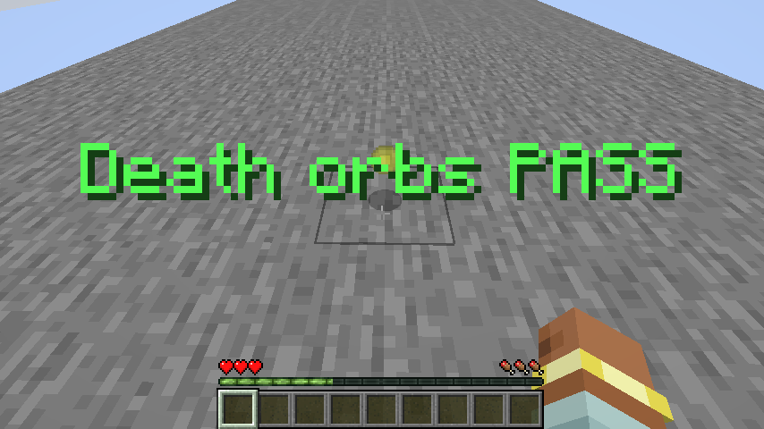
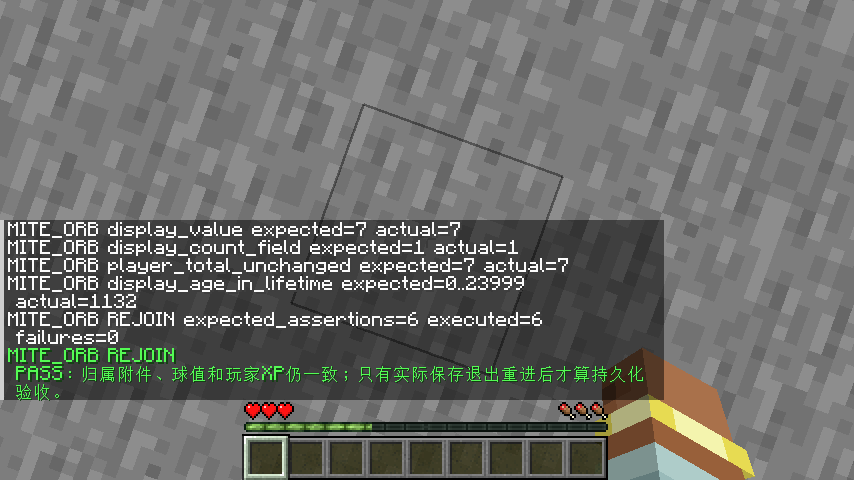
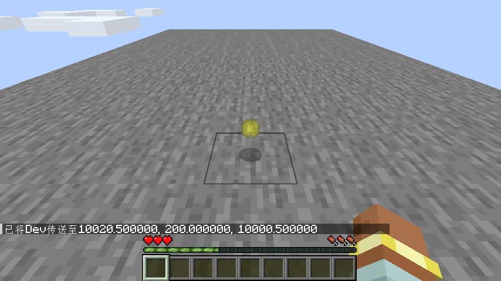

# 006：死亡经验球归属、延迟与持久化

开发与记录：NingMeng123。日期：2026-10-12；以下时间为本地时间（Asia/Shanghai）。

## 实现范围与代码状态

本功能在已推送的 `6422f04` 后的工作树实现；该提交完成的是 [005 死亡经验惩罚与负等级](005-death-experience.md)。本轮新增项已完成自动验证和真实客户端验收，记录时状态为“游戏实测通过”，尚未记录对应的新提交或远程推送。

原始字节码证据与现代行为选择见 [死亡经验球适配说明](../death-orb-adaptation.md)。本轮实现包括：

- 玩家死亡奖励进入每维度持久队列，在死亡位置经过 20 个可进行实体更新的 tick 后生成；入队当 tick 不计数，未加载位置不强制加载。队列独立于尸体，支持立即重生。
- 球使用版本化的 `mite:death_orb_owner` 附件保存并同步所属玩家 UUID；非所有者在拾取事件、冷却和经验修补之前被拒绝。
- 两端只跟随同维度、8 格内、存活且非旁观的所有者。所有者退出、死亡或离开范围后不继续追踪失效目标。
- 死亡球寿命为 24000 个实际实体更新 tick，普通球保持 6000。保存重进保留球龄；死亡球最终由服务端通知客户端删除。
- 所有涉及死亡球的合并均被禁止，包括相同所有者的球及生成时并入已有球；普通球仍可按新版规则合并。

## 自动验证

执行构建及 `runGameTestServer`。2026-10-12 **17:13:55.262**，GameTest 日志确认 `All 29 required tests passed`，构建和全部 122 项 JUnit 用例通过。

| 验证组 | 数量 | 覆盖与结果 |
| --- | --- | --- |
| JUnit | 122 项 | 经验数学 77 项、容量 28 项、死亡边界 17 项，全部通过 |
| 饱食度 GameTest | 3 组 | 原有容量、绑定与恢复回归通过 |
| 经验 GameTest | 9 组 | 正负经验、命令、事件、存档版本和模式回归通过 |
| 死亡 GameTest | 9 组 | 死亡惩罚、复制、同步、快照和掉落点数回归通过 |
| 新增死亡球 GameTest | 8 组 | 延迟、归属、经验修补前拦截、寿命、保存载入和合并路径通过 |

新增 8 组分别验证：精确第 20 个有效 tick 发放且不计入队 tick；队列 NBT 往返与非实体更新区块暂停；陌生人不能获取经验、修复装备或触发拾取冷却；所有者重生及相同 UUID 重登后的拾取；死亡球与普通球的寿命边界和 NBT 往返；实体扫描中的合并限制及普通球仍可合并；`ExperienceOrb.award` 不能合并到死亡球；真实世界 tick 下立即重生仍按延迟发球。

## 真实客户端主流程

从关闭的 `New World` 复制独立测试世界 **`MITE Death Orbs Test-006`**，安装 [独立测试包生成器](../../tools/testing/create_death_orb_smoke_pack.py) 的自动启动版本，再启动客户端：

```powershell
python tools/testing/create_death_orb_smoke_pack.py "run/saves/MITE Death Orbs Test-006" --auto-start-once
.\gradlew.bat runClient "-PmiteTestWorld=MITE Death Orbs Test-006" --console=plain
```

测试包只用于副本：在主世界 `x=9995..10035、y=199..204、z=9995..10005` 构造平台，临时强制加载该区域并传送玩家。死亡点为 `(10000.5,200,10000.5)`，重生点在 20 格外，避免自动捡回死亡经验。它启用和平难度、立即重生和 `doMobLoot=true`，关闭自然恢复、怪物生成及 `keepInventory`；不清空背包。结束时清理探针并移除测试区域的强制加载。

**17:17:59.927**，客户端日志记录：

```text
MITE_ORB expected_assertions=35 executed=35 failures=0
```

| 实机检查 | 实际结果 |
| --- | --- |
| 235 点经验真实死亡并立即重生 | 玩家归零；死亡点稍后生成 4 颗球，面额 `73+3+1+1`，按 `Value×Count` 汇总为 78 点 |
| 延迟生成 | 死亡后 1 tick 没有球，约 30 tick 时存在完整奖励；精确第 20 tick 由 GameTest 验证 |
| 死亡球附件 | 4 颗球均带实际死亡玩家 UUID，且各自 `Count=1` |
| 真实接触陌生归属的 7 点球 | 玩家未得经验，球未消失，仍为 `Value=7、Count=1` |
| 真实接触自身归属的 7 点球 | 球被消费，玩家得到 7 点；旁边的陌生球仍保留 |
| 41 颗相同归属球与 1 颗普通球重叠 | 等待 45 tick 后仍为 42 个实体，全部 `Count=1`；41 颗归属球保证覆盖原版实体 ID 模 40 的合并分组 |
| 寿命临界值 | 陌生归属球从 `Age=23998`、普通球从 `Age=5998` 开始，数 tick 后均消失，未给玩家增加经验 |
| 最终状态 | 玩家总经验 7，前方保留 1 颗陌生归属的 7 点球，供截图及保存重进检查 |



## 保存退出、重进与可见性

1. **17:18:45**通过游戏菜单正常保存退出到主菜单，日志确认全部维度保存完成。
2. **17:19:15**重新进入同一副本，自动测试没有再次运行；保留的陌生球仍可见，位于玩家前方约 2 格，没有被吸向当前玩家。
3. 手动执行 `/function mite_test:orb/rejoin_assertions`，只读取已生成球的状态，不重新召唤球或修改经验。
4. **17:19:42.552**，日志记录 `MITE_ORB REJOIN expected_assertions=6 executed=6 failures=0`：球数量 1、归属 UUID 正确、`Value=7`、`Count=1`、玩家 `XpTotal=7`，球的 `Age=1132`，处于有效寿命范围。





本轮实机共通过 **35 项主流程断言及 6 项重进回读断言**。重进读到的是此前已生成的球，不能据此推断待发队列的剩余倒计时已经通过实际关服验证。

## 验证边界与交付状态

17:22:31 客户端正常关闭，`runClient` 返回 `BUILD SUCCESSFUL`、退出码 0；本轮日志未发现 `ERROR` 或 `Exception`。最终 JAR 共 44 个条目，未包含 GameTest、smoke 测试包、reference 或测试世界内容。

- 尚未实际等待完整 20 分钟；本次寿命证据是临界 Age 测试、GameTest NBT 往返以及实机重进后读取 Age。
- 尚未使用两个真实客户端联机。实机陌生归属测试使用与当前玩家不同的 UUID，跨玩家服务端行为由 GameTest 覆盖。
- 待发队列的剩余倒计时保存载入由 GameTest NBT 往返验证；本次没有在球尚未生成时关闭并重启实际服务器。
- 实机没有用陌生球尝试修补受损装备；提前拒绝经验修补及冷却的路径由 GameTest 验证。
- 原版三条窄物理拾取射线及铁栏杆等特殊规则尚未移植，当前保留现代碰撞与拾取可达性行为。正常保存通过不代表异常断电下的跨文件原子事务已验证。

测试数据包、测试世界及本机日志属于开发验收资料，不作为模组运行资源。005 记录保持其当时的历史状态；本轮新增覆盖以本页为准。拟用中文提交说明：`复刻死亡经验球归属与延迟掉落并通过游戏重进验证`。
