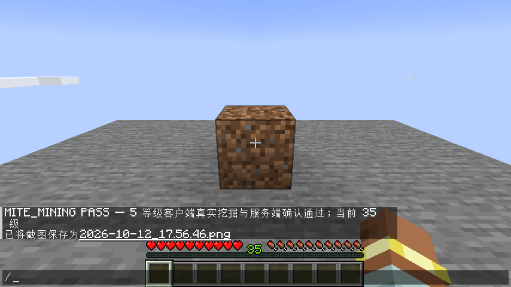
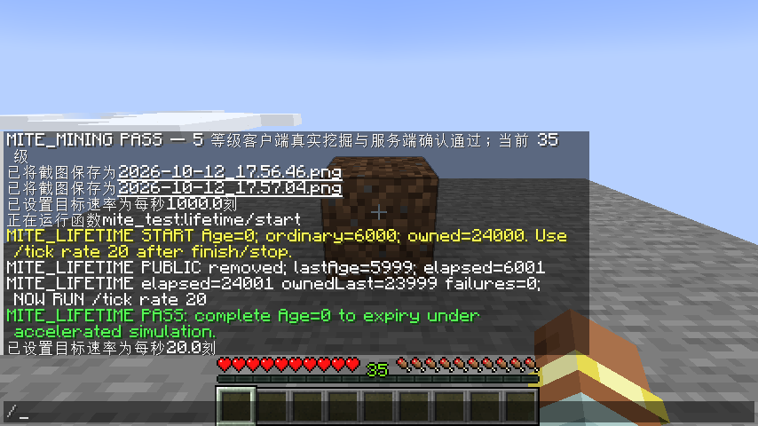

# 007：等级对采集速度的倍率

开发与记录：NingMeng123。日期：2026-10-12；时间为 Asia/Shanghai。基线为已推送的 `d6193c6`，本轮工作树状态为“游戏实测通过”，新提交尚未记录。005、006 保留其历史验收内容。

## 范围与自动验证

`MiningRules` 与 `PlayerMiningEvents` 将现代已修正速度乘以 `1+0.02×clamp(level,-40,200)`。创造、旁观、已取消事件及非正速度保持原值；工具和环境输入不重算。原作便携下限、空手限制和完整采集公式不在本项范围，详见 [采集等级适配](../mining-level-adaptation.md)。

137 项 JUnit 全部通过。**17:49:27**，GameTest 日志确认 `All 34 required tests passed`，其中新增 5 组采集测试，原有 29 组回归通过。

加入客户端测试程序后，**18:01:15.457** 再次以服务端启动目标运行，34 组全部通过，确认客户端专用类不会影响服务端加载。

## 真实客户端操作

从关闭的 `New World` 复制独立副本 **`MITE Mining Test-007`**，使用显式测试属性启动：

```powershell
.\gradlew.bat runClient "-PmiteTestWorld=MITE Mining Test-007" -PmiteMiningSmoke=true --console=plain
```

测试程序仅在指定副本与显式属性同时启用时运行，其代码不进入发布 JAR。它在 `x=11001..11009、y=199..203` 的测试区域准备平台，清空测试玩家背包、移除药水效果，设置生存与和平模式，关闭方块掉落和怪物生成，并调整经验。以上操作仅用于独立副本，结束时玩家设为 35 级。

各案例以正常 `keyAttack` 输入驱动原版客户端破坏控制器，检查客户端速度与破坏进度，并在服务端线程确认目标变为空气；不是直接调用删除方块命令。挖掘对比保持 **20 TPS**。

首轮受测试环境干扰：泥土掉落被捡到主手，改变了预设的空手条件。修正仅限测试程序，关闭 `doTileDrops` 并清理指定区域的遗留物品，然后重新运行。

**17:56:32.184**，日志记录 `MITE_MINING PASS`。实际完成以下 **5 个实机案例**，累计 171 个客户端 tick：

| 等级 | 预期倍率 | 记录的客户端 tick | 结果 |
| --- | --- | --- | --- |
| 0 | 1 | 16 | 通过 |
| −40 | 0.2 | 81 | 通过 |
| 35 | 1.7 | 14 | 通过 |
| 200 | 5 | 8 | 通过 |
| 5 | 1.1 | 19 | 通过 |

计数包含首 tick 和后续控制器的 5 tick 连挖冷却，因此不能用表中总数计算严格耗时倍率；倍率与进度由独立检查验证。表格按完成的 5 个实机案例计数。



## 追加经验球完整寿命验证

通过 [寿命测试包生成器](../../tools/testing/create_orb_lifetime_pack.py) 在同一副本补测，普通球与死亡球均从 Age=0 开始，全程没有修改 Age，也没有强制加载区块。玩家留在测试平台附近。操作顺序为命令栏 `/tick rate 1000`、`/function mite_test:lifetime/start`，看到结果后手工 `/tick rate 20`；中止也须手工恢复 20。此加速验证与上面的 20 TPS 挖掘对比分开记录。

早期数据包在函数内执行需权限 3 的 `/tick`，受函数权限 2 限制而出现解析错误；已改为命令栏手工控制速率，数据包不自动恢复速率。修复后重启日志未再出现解析错误。

| 时间 | 实际结果 |
| --- | --- |
| 17:57:37.334 | 测试开始，两种球均为 Age=0 |
| 17:57:43.323 | 普通球消失，最后读到 `Age=5999`，观察计数 `elapsed=6001` |
| 17:58:01.323 | 死亡球消失，最后读到 `Age=23999`，`elapsed=24001`、`failures=0`，日志报告 PASS |
| 17:58:49.698 | 命令栏执行恢复 20 TPS 成功 |

观察函数在实体更新之前读取，因而消失被观察到时计数多 1；最后存活 Age 与消失时计数共同支持 6000/24000 实体 tick 的寿命边界。本次约 24 秒墙钟时间完整运行了 24000 个实体更新 tick，等价于正常 20 TPS 下的 20 分钟模拟时间，并非实际等待了 20 分钟。补测不修改生产行为，也不替代待发队列实际关服重启验证。



## 打包与遗留边界

17:59:55 全部维度保存完毕，18:00:26 客户端正常关闭，`runClient` 返回 `BUILD SUCCESSFUL`、退出码 0。测试期间临时关闭的失焦暂停选项已恢复。

最终 JAR 共 47 个条目，不含测试代码、测试资源或 reference 内容；最终运行日志未发现 `ERROR` 或 `Exception`。本轮实机覆盖单人副本的采集倍率，没有因此验证双客户端联机、完整采集成长流程或旧版便携下限。中文提交说明：`复刻等级采集速度倍率并完成游戏实测与经验球全寿命验证`。
