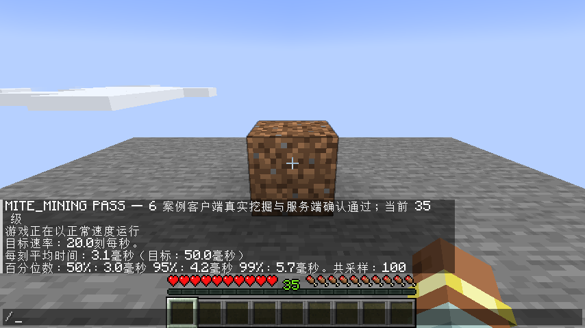
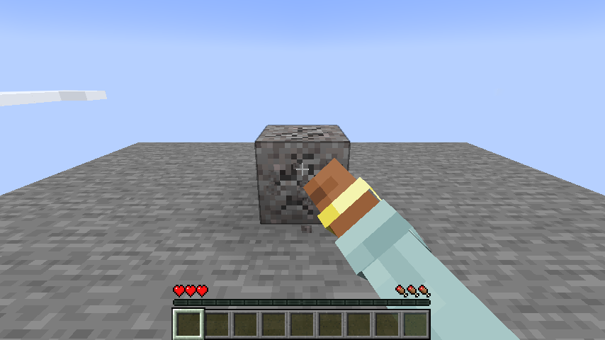

# 008：R196 基础挖掘进度与开局硬度

开发与记录：NingMeng123。日期：2026-10-12，时间为 Asia/Shanghai。基线为 `8559ede`，本轮在其后的工作树上验证；007 的旧基础速度计时保留为历史记录。

## 范围与自动验证

R196 证据、float 运算顺序、严格瞬破边界及局部硬度映射见 [基础挖掘适配](../mining-base-adaptation.md)。本轮替换通用单次进度公式，草方块有效硬度改为 0.5，砂与红沙改为 0.4，继续使用包含一次等级倍率的现代强度输入。没有修改全局硬度、爆炸抗性或地形生成。

运行 `gradlew.bat build runGameTestServer --console=plain` 成功，141 项 JUnit 全部通过。**18:52:32** 日志确认 `All 36 required tests passed`，包括 7 组采集 GameTest。覆盖精确 float 位模式、阈值前后、逐次累加计数、零硬度与取消事件、模式及保存加载、真实服务端 START/STOP 和延迟破坏、正确与错误工具掉落。

## 实机方法

从关闭的 `New World` 复制独立副本 **`MITE Mining Test-008`**，原存档不参与测试。启动命令：

```powershell
.\gradlew.bat runClient "-PmiteTestWorld=MITE Mining Test-008" -PmiteMiningBaseSmoke=true --console=plain
```

测试程序仅在显式属性与指定副本同时满足时修改世界，代码不进入发布 JAR。它在 `x/z=11001..11009、y=199..203` 准备石平台，设置生存、和平、无效果、空手、站在地面，固定晴天中午，关闭方块掉落及生物生成，逐例设置经验和食物。树叶设为持久，避免自然腐烂。以上均为测试副本设置。

程序通过正常 `keyAttack` 输入驱动客户端破坏控制器，检查单次进度精确位模式，并在服务端线程确认目标为空气；挖掘阶段不直接移除方块。测试结束保留 35 级和泥土目标。使用默认 20 TPS，不通过 `/tick rate` 加速挖掘。

## 首轮异常及复测条件

首轮泥土、草方块、砂、砂砾分别记录 257、261、210、313 个客户端 tick，通过预期有效累加次数加控制器开销的检查。**18:54:57.106**，树叶记录 145 tick，超出 103..109 的允许范围，测试报告 FAIL 并停止，35 级案例未执行。

首轮没有逐 tick 的目标和进度诊断，不能把该偏差直接归因于生产公式。代码检查发现，测试器原先只在 tick 结束时固定视角，渲染帧的鼠标转向仍可能影响下一 tick 的准星；原版控制器在目标偏离后会取消并重置挖掘。复测将固定视角移到每 tick 选取目标之前，同时逐 tick 检查命中目标与进度位模式；不调整进度、不跳过正常控制器，也不扩大时间容差。

**18:59:10.531**，加入诊断后的下一次启动在泥土案例捕获到 `Window focus was lost during mining`，随即停止。准备条件因此补上“窗口处于前台且无覆盖层，并连续稳定 3 tick”；进入游戏后点击场景取得鼠标输入，再开始最终复测。该修改只作用于测试程序。

## 复测结果

最终复测于 **19:02:03.190** 报告 `MITE_MINING PASS`，6 个案例均通过逐 tick 的准星、输入与进度检查，且服务端逐例确认目标为空气：

| 案例 | 有效 float 累加次数 | 实际客户端 tick | 20 TPS 有效累加基准 | 完成时间 |
| --- | --- | --- | --- | --- |
| 0 级泥土 | 256 | 257 | 12.8 秒 | 19:01:09.340 |
| 0 级草方块 | 256 | 261 | 12.8 秒 | 19:01:22.642 |
| 0 级砂 | 205 | 210 | 10.25 秒 | 19:01:33.389 |
| 0 级砂砾 | 308 | 313 | 15.4 秒 | 19:01:49.294 |
| 0 级橡树叶 | 103 | 108 | 5.15 秒 | 19:01:54.941 |
| 35 级泥土 | 151 | 156 | 7.55 秒 | 19:02:02.992 |

整轮计数 `elapsedClientTicks=1820` 包含开始前等待焦点、准备和同步，不是单纯挖掘时间。**19:02:48.459** 通过游戏命令栏 `/tick query` 确认正常运行、目标 20.0 TPS，采样每刻平均 3.1 ms；本轮没有修改 tick rate。





## 验证边界

客户端逐次执行 float 加法，服务端仍按经过的 tick 数计算并保留现代 STOP 的 0.7 容差。两端共用单次进度公式，不代表累计过程位级相同。正常 20 TPS 的理论秒数取有效累加次数除以 20；实际输入计数还含首 tick 和连挖冷却，墙钟时间也受运行性能影响。

空手与错误工具门槛、材料采集等级、便携下限、其他旧版硬度和完整饥饿/耐久规则不在本轮范围。现代工具效率、环境修正、掉落路径及竹子剑的专用覆写保留。实机是单人集成服务端，不等同两个真实客户端的联机验收。

## 保存与交付

**19:03:51** 全部维度保存完成，**19:03:59** 客户端正常关闭；`runClient` 返回 `BUILD SUCCESSFUL`、退出码 0。测试临时修改的 `pauseOnLostFocus` 已恢复为 true。最终客户端日志没有 `ERROR` 或 `Exception`；先前失败单独记录，未作为通过结果。

发布 JAR 为 `build/libs/mite-0.1.0.jar`，共 49 个条目，不包含 GameTest、客户端测试器、源码及 reference 内容。中文提交说明：`还原R196基础挖掘进度与开局硬度并通过游戏实测`。远程仓库：[mite-neoforge-1.21.1](https://github.com/65658dsf/mite-neoforge-1.21.1)。
