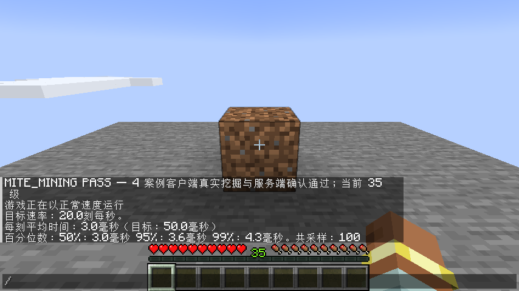

# 009：食物能量耗尽时的采集减速

开发与记录：NingMeng123。日期：2026-10-12，Asia/Shanghai。基线为已推送的 `99356a6`；本记录对应其后的饥饿采集功能工作树。

## 功能范围

R196 在没有食物能量时将采集强度除以 5，再计算等级倍率。本轮沿用既有食物条映射：当前饥饿值大于 0 即有能量，空条才触发减速；剩半格时不减速。创造、旁观、已取消事件和非正输入速度维持原有行为。双资源营养、完整代谢及便携下限仍待后续实现，详见 [饥饿采集适配](../mining-hunger-adaptation.md)。

## 实机方法

从关闭的 `New World` 复制独立副本 **`MITE Mining Test-009`**，不操作原存档。通过显式属性启动测试器：

```powershell
.\gradlew.bat runClient "-PmiteTestWorld=MITE Mining Test-009" -PmiteMiningHungerSmoke=true --console=plain
```

测试器固定存档、玩家位置和目标，采用正常 `keyAttack` 及破坏控制器路径。逐 tick 检查焦点、准星、食物值和进度位模式，服务端逐例确认方块消失，不通过测试代码直接删除目标。该模式与 007、008 模式互斥，代码不进入发布 JAR。

副本采用普通难度以避免和平模式自动补食，关闭怪物生成、方块掉落和自然回血，固定天气、清空背包与药水效果。每例设置初始食物与生命；这里的食物变化通过正常同步到客户端，是条件测试，不把直接设置食物值称为玩家完成了吃食物操作。

## 验证边界

按单块有效 float 累加次数计算理论 20 TPS 秒数；实机控制器计数额外包含首次输入或连挖冷却。`/5` 表示强度比例，不保证取整后每种方块的完成 tick 数严格乘 5。整个挖掘对比保持 20 TPS。

本轮实机为单人集成服务端，不冒充双客户端联机、完整营养代谢或成长路线验证。工具限制需要先接入燧石开局材料与配方，尚未启用。

## 自动验证与首轮记录

`gradlew.bat build runGameTestServer --console=plain` 成功，143 项 JUnit 全通过，**19:18:07** 日志确认 `All 40 required tests passed`。新增 2 项 JUnit 和 4 组 GameTest，覆盖浮点运算顺序、半格阈值、干海带实际消费调用后恢复、正负等级与工具/浮空/急迫叠加、空条 NBT 保存加载、四种模式及事件取消。GameTest 不被记为实机吃食物动画验证。

首轮正常食物和空条案例分别记录 104、517 个客户端 tick，通过预期检查。**19:19:20.759**，恢复食物案例记录 169 tick，超出 103..109 的允许范围，测试自动停止。期间曾通过界面工具单击游戏场景，可能干扰持续攻击；由于缺少控制器重置轨迹，不能断言这是唯一原因。复测保持相同生产代码、测试向量和容差，挖掘期间不发送额外界面输入。

## 最终实机结果

**19:22:18.821**，完整复测报告 `MITE_MINING PASS`，4 个案例均通过逐 tick 检查及服务端目标消失确认，计数为 `[104,517,108,307]`。全部目标为硬度 0.2 的持久橡树叶，玩家空手、站立、无药水效果。

| 等级与食物 | 强度 | 有效累加基准 | 实际客户端 tick | 20 TPS 有效时间 | 完成时间 |
| --- | --- | --- | --- | --- | --- |
| 0 级，1 点食物 | 1.0 | 103 | 104 | 5.15 秒 | 19:21:31.266 |
| 0 级，0 点食物 | 0.2 | 512 | 517 | 25.6 秒 | 19:21:57.371 |
| 0 级，恢复 1 点食物 | 1.0 | 103 | 108 | 5.15 秒 | 19:22:03.018 |
| 35 级，0 点食物 | 0.34 | 302 | 307 | 15.1 秒 | 19:22:18.619 |

整轮 `elapsedClientTicks=1063` 包含准备及同步，不能视为纯挖掘时间。测试结束恢复到 35 级和满食物条，保留泥土目标。**19:23:14.112** 命令栏 `/tick query` 确認目标 20.0 TPS、每刻平均 3.0 ms；全程没有调整 tick rate。



## 保存与交付

**19:24:16.701** 全部维度保存完成，**19:24:24.226** 客户端正常关闭，`runClient` 返回 `BUILD SUCCESSFUL`、退出码 0。最终运行日志无 `ERROR` 或 `Exception`；本轮未更改失焦暂停设置，仍为 true。

`build/libs/mite-0.1.0.jar` 共 49 个条目，不含 GameTest、客户端测试器、源码和 reference 内容。提交说明：`复刻食物能量耗尽时的采集减速并通过游戏实测`。目标仓库：[mite-neoforge-1.21.1](https://github.com/65658dsf/mite-neoforge-1.21.1)。
