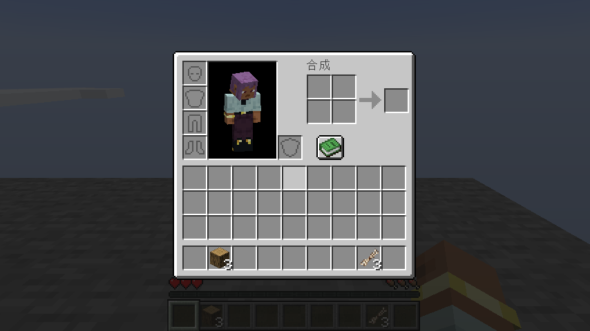
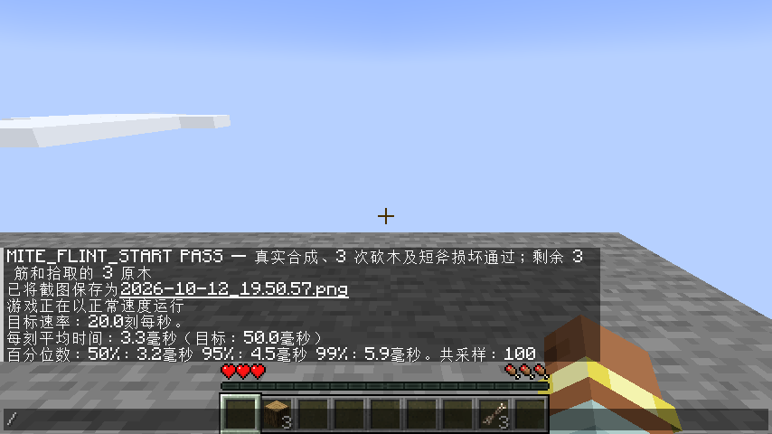
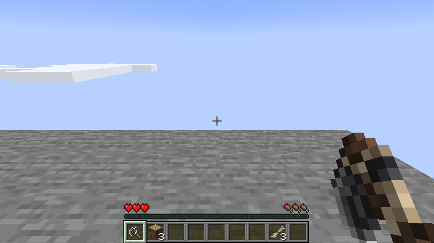
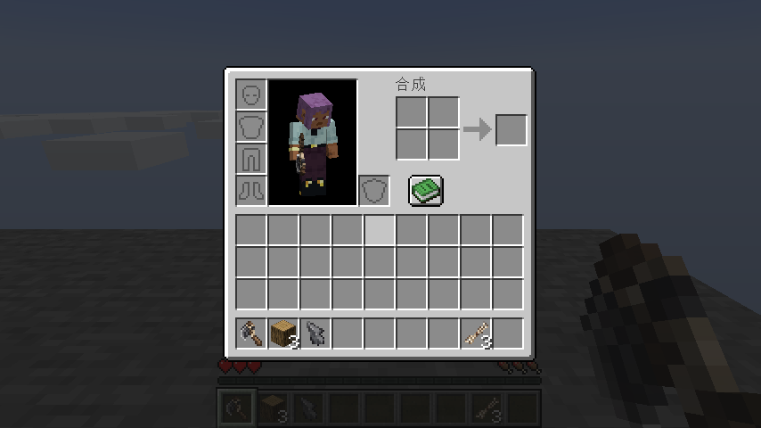

# 010 燧石开局材料、短斧与新版材质验收

开发者：NingMeng123。日期：2026-10-12。基线：`9609ca3` 加本轮工作树；规则见 [燧石开局适配](../flint-start-adaptation.md)，资产过程与完整提示词见 [材质制作记录](../art/textures-010.md)。

## 环境与测试边界

Minecraft 1.21.1、NeoForge 21.1.259、Java 21；单人集成服务端，独立测试副本 `MITE Flint Start Test-010` 从已关闭的 `New World` 复制。原存档未修改。本轮不改变现代地形。

```powershell
.\gradlew.bat runData --console=plain
.\gradlew.bat build runGameTestServer --console=plain
.\gradlew.bat runClient '-PmiteTestWorld=MITE Flint Start Test-010' -PmiteFlintStartSmoke=true --console=plain
```

开发用客户端测试器只存在于 `gametest` 源集。必须显式打开参数，服务端每次任务均校验精确存档目录和玩家 UUID；初始化在专用平台提供 **4 碎片、1 皮革、2 木棍**，设置 0 级、有食物、生存、和平模式。此原料供应不算自然采砂/打牛或完整开局路线验收。

打开真实背包界面后，测试器通过普通容器点击包逐格放入原料，并通过结果槽快捷转移完成三次合成；没有直接发放成品或改写合成结果。双端核对数量、空网格及空光标，然后装备真实合成的短斧。砍木使用普通持续攻击输入，每 tick 检查目标、食物、强度 2.5 与进度 bits `0x3b855555`，再由服务端确认目标变空气、损伤和实际掉落。拾取通过移动玩家到真实掉落物附近自然发生，不直接修改掉落数量或背包。

## 自动验证

- 19:40:33 数据生成通过，生成 16 个配方及 16 个对应解锁进度。
- 19:45:14 构建完成；148 项 JUnit、52 组 GameTest 全通过，失败数 0。
- 新增 5 项 JUnit：13 个字面磨损向量、浮点运算次序边界、工具基准与砂砾全部时运分支穷举及钳制。
- 新增 5 组合成 GameTest：3,048 个网格布局、100 个有效输入，错误及多余原料、真实背包快捷取料和真实红石自动合成器。
- 新增 4 组工具 GameTest：攻击总值/冷却/133 磨损、真实服务端破坏三块原木及掉落、物品保存加载、错误工具/零硬度/创造旁观边界、右键不剥皮。
- 新增 3 组砂砾 GameTest：固定随机种子的 256 次真实掉落实体、丝触与禁掉落/取消保护、非玩家及空掉落表保护、额外模组掉落保留。

概率正确性来自纯规则分支穷举，不以 256 次随机样本频率当成概率证明。自动合成器验证当前普通配方，不表示尚未实现的加工时间、经验和品质规则已适配。

## 首轮发现与修正

19:46:33–19:46:36 三次真实合成通过。19:46:49、19:47:01、19:47:14 三次砍木通过，客户端计数为 `[247,251,251]`，损伤为 160、320，第三次消失；服务端累计实际原木掉落为 1、2、3。

测试器仅移动到目标中心，未能收齐散落较远的原木，因此首轮未取得最终 PASS。19:48:03 保存退出后记录 `FAIL phase=WAIT_PICKUP`（连接已断开）。修正仅限测试器收尾：每 10 tick 移向剩余真实原木掉落实体，再等待正常拾取。生产逻辑、合成步骤、挖掘输入与允许范围均未改。

## 最终实机结果

**19:50:26.380** 完整复测取得 `MITE_FLINT_START PASS`，全程 872 个客户端 tick（包含合成、同步和拾取，不能当成纯挖掘时间）。三次合成的服务端结果如下：

| 时间 | 操作 | 库存结果 |
| --- | --- | --- |
| 19:49:44.316 | 4 碎片合成燧石 | 1 燧石、1 皮革、2 木棍，无碎片 |
| 19:49:45.133 | 1 皮革制筋 | 1 燧石、4 筋、2 木棍，无皮革 |
| 19:49:47.329 | 背包合成短斧 | 1 把全新短斧、3 筋，燧石和木棍耗尽 |

三次取结果后，服务端合成网格和光标都为空；客户端库存同时匹配。

| 时间 | 第几块原木 | 实际客户端 tick | 服务端短斧损伤 | 累计真实原木掉落 |
| --- | --- | --- | --- | --- |
| 19:50:00.136 | 1 | 247 | 160 | 1 |
| 19:50:12.929 | 2 | 251 | 320 | 2 |
| 19:50:25.733 | 3 | 251 | 短斧损坏，库存数量 0 | 3 |

每块有效 float 累加基准为 246 次，即 20 TPS 下 12.3 秒。实机计数还包括首次输入、连挖冷却与同步；三次均在预定 246..252 范围内。最终双端库存确认 3 筋、3 原木、0 短斧，所有目标服务端确认变为空气。**19:51:30** `/tick query` 显示正常运行、20.0 TPS、每刻平均 3.3 ms；整轮未调整 tick rate。





功能 PASS 后，单独用 `/give` 添加 1 把短斧和 1 碎片作材质样品；这两件样品不属于以上合成和耐久验收结果。查看手持模型、背包三种新物品图标以及中文物品反馈，未见紫黑缺失材质。下图中的 3 筋仍是合成后剩余物。





## 发布包检查

19:54:45.227 全部维度保存完成，19:55:01.349 客户端正常退出；`runClient` 返回 `BUILD SUCCESSFUL`，退出码 0。最终复测运行日志无 ERROR、Exception 或模型/材质缺失报告。

`build/libs/mite-0.1.0.jar` 共 109 个条目，包含 16 配方、16 解锁进度、3 模型和 3 张 16×16 PNG；无 GameTest、客户端测试器、反编译源码、reference 内容或生成缓存。没有把游戏测试原料供应或测试平台带入发布包。

本轮 JAR SHA-256：`16ed9933673d74dfed3c4129345e814bc34a16144ea55a7234787605760ad505`。提交说明：`加入燧石开局材料与短斧并重绘新版像素材质`；目标仓库：[mite-neoforge-1.21.1](https://github.com/65658dsf/mite-neoforge-1.21.1)。

双客户端联机、完整开局成长、所有现代斧标签目标及自然长时资源取得尚未实测；完整矿物掉落、品质、工具门槛和制造加工规则仍在后续范围。
