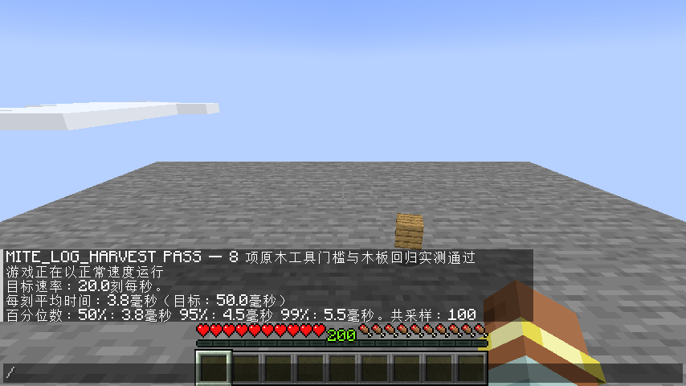

# 011 原木采集工具门槛验收

开发者：NingMeng123。日期：2026-10-12。基线：`3c02d75` 加本轮工作树；独立来源与适配范围见 [原木门槛规格](../log-harvest-adaptation.md) 和 [结构化规则](../../spec/r196-log-harvest.json)。

## 环境与执行

Minecraft 1.21.1、NeoForge 21.1.259、Java 21。专用副本 `MITE Log Harvest Test-011` 从已关闭的 `New World` 复制，原存档未改。开发测试器必须显式启用，并在每次服务端操作前检查精确存档目录与玩家 UUID；测试工具、原木和平台由测试器提供，不把本轮当作自然取得工具或完整成长路线验证。

```powershell
.\gradlew.bat runData --console=plain
.\gradlew.bat build runGameTestServer --console=plain
.\gradlew.bat runClient '-PmiteTestWorld=MITE Log Harvest Test-011' -PmiteLogHarvestSmoke=true --console=plain
```

20:07:36 数据生成成功：保留已有 32 个配方/进度文件，新增 2 个标签。默认受限标签由独立展开的 1.21.1 原版 LOGS 清单、规格和生成结果三方核对，精确为 40 个 ID；竹块不在其中，低阶工具标签默认只有木斧。

## 自动验证结果

20:09:35 构建成功；**148 项 JUnit、59 组 GameTest 全通过**。本轮新增 7 组 GameTest，覆盖：

- 40 种原木与空手、普通物、错误工具、木斧及合格斧的矩阵，燧石短斧的固定进度 bits `0x3b855555`。
- 正负等级、急迫、效率和速度属性不能替代工具资格；副手斧不能替代不合格主手。
- 木板、工作台、箱子、竹块、泥土、砂砾、树叶、零硬度植物及石头原有行为回归。
- 真实 `ServerPlayer.gameMode.destroyBlock` 拒绝不合格工具，保持原木、零掉落、零磨损；`destroyAndAck` 发出包含原木的客户端回补包。合格短斧实际产出 1 原木并扣 160 耐久。
- START 后先挖 200 次服务端进度更新，再切木斧发 STOP、继续 300 次延迟更新，仍不能移除；改为空手也不能移除。另一个新玩家会话以合格工具走正常延迟完成路径，达到预期进度后成功。
- 创造空手破坏、旁观禁止破坏、冒险 `CAN_BREAK` 与工具门槛同时生效，以及其他事件取消不会被撤销。
- 物品 Tool 组件反例：只有速度、只有斧能力、禁止掉落、错误目标、被提高速度的低阶木斧均不放行；符合条件的自定义组件可用。

服务端 tick 调用是集成测试，不冒充用户正常等待的墙钟时间。Tool 组件测试也不等于实际安装第三方模组测试。

## 实际客户端八项测试

通过正常持续攻击输入、客户端控制器及正常挖掘包操作，不直接调用服务端破坏方法代替玩家操作。每 tick 检查目标、主手、模式、等级、食物、焦点与位级破坏进度；完成或观察窗口结束后，由服务端独立确认方块、掉落及工具损伤。服务端设置物品后，客户端也通过正常快捷栏选择包选中第 0 格，避免复制存档旧选中格干扰。

测试平台开启方块掉落。四个被拒绝案例逐 tick 进度均为 0，服务端最终确认原木仍在、掉落为 0、损伤为 0。表中的观察 tick 数只表示持续按键观察时长，不表示“此后可以破坏”。

| 完成时间 | 实机场景 | 客户端 tick | 实际服务端结果 |
| --- | --- | --- | --- |
| 20:10:19.808 | 0 级空手挖橡木原木 | 80，观察窗口 | 原木保留，无掉落 |
| 20:10:23.045 | 0 级持木棍挖橡木原木 | 60，观察窗口 | 原木保留，无掉落 |
| 20:10:27.296 | 200 级持木斧挖橡木原木 | 80，观察窗口 | 原木保留，木斧无损伤 |
| 20:10:31.548 | 0 级持钻石镐挖橡木原木 | 80，观察窗口 | 原木保留，镐无损伤 |
| 20:10:44.146 | 0 级燧石短斧挖橡木原木 | 247，基准 246 | 目标消失，掉落 1，损伤 160 |
| 20:10:56.944 | 0 级燧石短斧挖去皮绯红菌柄 | 251，基准 246 | 目标消失，掉落 1，损伤 160 |
| 20:11:05.200 | 0 级石斧挖橡木原木 | 160，基准 154 | 目标消失，掉落 1，损伤 1 |
| 20:11:15.996 | 200 级空手挖橡木木板 | 211，基准 205 | 目标消失，掉落 1 |

每个允许案例均在预定有效累加基准至基准 +6 的范围内；额外时间来自首次输入、连挖冷却与同步。200 级木板案例用既有 5 倍等级速度减少等待，不改变目标硬度或测试 tick rate。

**20:11:15.996** 取得 `MITE_LOG_HARVEST PASS`，计数 `[80,60,80,80,247,251,160,211]`，整轮 1286 客户端 tick，包含准备与同步。**20:12:04.077** `/tick query` 确认正常运行、20.0 TPS、平均每刻 3.8 ms；全程未调整 tick rate。



PASS 后单独在原测试坐标放置一块橡木原木，使用 UI 空手单击，观察到快捷栏上方提示“需要燧石短斧或更好的斧头”，原木仍在。这是提示检查，不计入上述八项自动断言或它们的计时。

## 保存、发布与边界

20:14:01.328 全部维度保存完成；20:14:19.228 正常退出客户端。`runClient` 返回 `BUILD SUCCESSFUL`，退出码 0；本轮运行日志无 ERROR 或 Exception。

`build/libs/mite-0.1.0.jar` 共 119 个条目，包含两个门槛标签，不含 GameTest、客户端测试器、参考源码或生成缓存。SHA-256：`24dd2c3645ce6317b1390ec7c9a8be6db80c38b0d29ab1669dc9c423e96e8a63`。

本轮验证单人集成服务端与自动服务端测试；两个真实客户端、第三方模组组合、数据包标签热重载尚未实测。默认标签的首次客户端同步已由实际八例覆盖。石矿采集门槛、完整材料等级与便携下限仍待后续；现代结构木板可通向工作台和石斧，本轮不保证必须只走燧石路线。

中文提交说明：`复刻原木采集工具门槛并通过八项游戏实测`。目标仓库：[mite-neoforge-1.21.1](https://github.com/65658dsf/mite-neoforge-1.21.1)。
