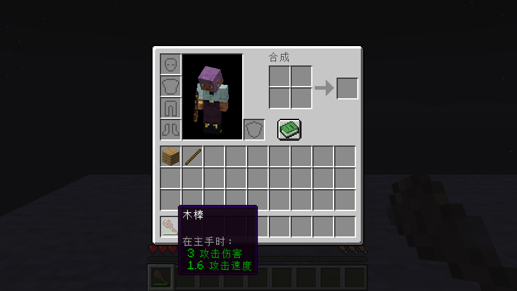
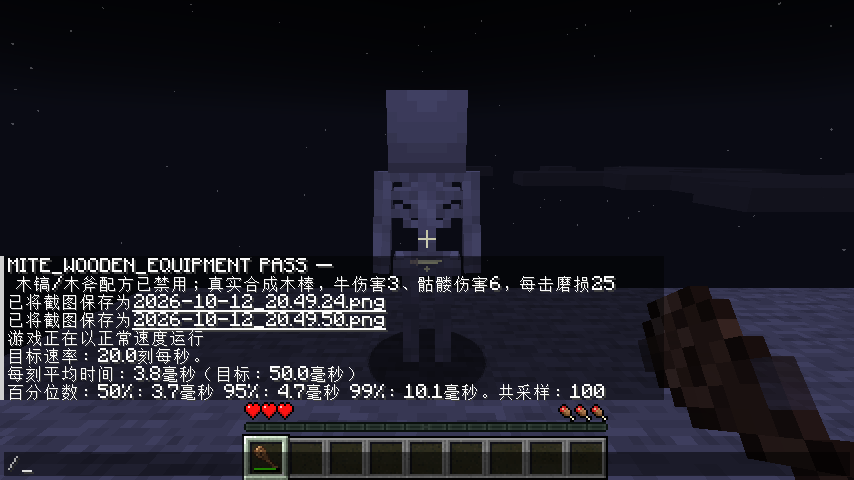

# 012 木棒与木制装备来源验收

开发者：NingMeng123。日期：2026-10-12。基线：`f307f0e` 加本轮工作树。独立来源和明确的现代适配见 [木棒适配](../wooden-club-adaptation.md) 与 [结构化规格](../../spec/r196-wooden-club.json)。

## 自动验证

Minecraft 1.21.1、NeoForge 21.1.259、Java 21。20:39:41 `runData` 成功；生成的高效目标标签精确包含 21 个不同方块。20:41:49 `build runGameTestServer` 成功，**150 项 JUnit、67 组 GameTest 全通过**。

本轮新增 2 项数值测试和 8 组 GameTest，检查：

- 竖排两木板加木棍得到 1 木棒，默认耐久 400；木镐、木斧的配方及配方书进度均不加载，木铲/木锄保留。
- 实际红石驱动两个自动合成器，旧木镐/木斧图样没有产物且不消耗输入。
- 奖励箱及试炼密室入口各 64 个固定随机种子，以未经过战利品修改器的同种子结果为对照；只移除木镐/木斧，其他顺序、数量和组件不改变、不重抽。
- 实际构建创造物品栏及搜索集合，不出现木镐/木斧，仍有木棒、木铲和木锄；旧工具注册继续有效。
- 真实玩家攻击：普通无甲目标 3 点、四类骷髅 6 点、去甲僵尸及骷髅马 3 点；强制已有锋利 I 的木棒对骷髅为 7，证明附魔伤害没有重复翻倍。木棒不横扫，铁剑在同一场景中横扫生效、伤害与磨损维持原值。
- 连续 16 次成功攻击，每击耗损 25，第 16 次损坏；第 8 次保存/读取物品后仍保留耐久 400、损伤 200。
- 玻璃板强度 2，实际服务端破坏后耗损 7；整玻璃/冰/蜘蛛网强度 1。木棒无剑的砍竹特权，原木仍受斧头门槛，创造破坏不耗损。
- 木棒附魔能力 10、五项白名单、木板不能材料维修，命令或既有附魔组件读写保留；石剑/铁剑标签、蜘蛛网速度、耐久、锋利资格及铁锭维修均回归正常。

## 实际客户端

已打开实际客户端，用正常客户端工作台交互、容器点击包和攻击包验证；没有直接调用服务端合成或攻击方法替代这些操作。测试器只在显式开启 `mite.woodenEquipmentSmoke` 且目录精确匹配测试副本时运行，每次服务端操作核对存档目录及玩家 UUID。

| 时间 | 实机检查 | 服务端及客户端结果 |
| --- | --- | --- |
| 20:48:00.241 | 完整木镐配方 | 双端输出为空，随后快捷回收 3 木板、2 木棍 |
| 20:48:04.131 | 完整木斧配方 | 双端输出为空，随后快捷回收 3 木板、2 木棍 |
| 20:48:07.480 | 竖排两木板、一木棍，快捷取出 | 得到 1 木棒，剩 1 木板、1 木棍，网格与光标为空 |
| 20:48:09.629 | 持刚合成的木棒，落地满冷却攻击牛 | 生命 10→7，损伤 0→25，双端一致 |
| 20:48:11.387 | 同一木棒，落地满冷却攻击骷髅 | 生命 20→14，损伤 25→50，双端一致 |

**20:48:11.390** 记录 `MITE_WOODEN_EQUIPMENT PASS`，全过程 372 客户端 tick，包含准备、放料、同步及冷却。测试使用普通难度、夜间、无 AI/装备/减伤目标，防止和平难度消失、燃烧、暴击或护甲混淆伤害。

人工显示检查确认中文“木棒”、3 攻击伤害、1.6 攻击速度以及背包和第一人称新版风格贴图，无缺失纹理。耐久损伤由服务端与客户端状态断言确认；截图中的普通提示不显示数值耐久。20:50:07.266 `/tick query` 确认 **20.0 TPS，平均 3.8 ms/tick**；本轮未加速。






## 保存与发布检查

20:50:48.460 全部维度保存完成；20:51:09 正常退出，`runClient` 返回 `BUILD SUCCESSFUL`、退出码 0。返回主菜单时 OpenAL 记录了一次 `Allocate new source: Invalid name parameter` 及声音句柄警告；发生在存档保存完成后，未造成崩溃，也没有影响本轮功能断言。保留这一观察，不将日志描述为全无错误。

本轮 JAR 为 `build/libs/mite-0.1.0.jar`，152 个条目，含木棒模型、16×16 PNG、条件配方、标签与战利品配置，不含 GameTest、客户端测试器、参考源码或缓存。SHA-256：`3e62d8e69c5247c43d80eece8bca1758d32c63df37252999554ed91d3533123e`。

本轮未进行两台真实客户端联机、第三方模组组合或已发布旧版本存档的实际迁移；物品兼容已检查注册保留及 codec 读写。木棒旧式格挡、触及、眩晕和品质未实现；木镐移除后的完整首镐成长路线仍留待金属阶段补齐。不能由本项通过推出完整 MITE 生存进度已经完成。

中文提交说明：`复刻木棒并移除木镐木斧的常规获取`。目标：[mite-neoforge-1.21.1](https://github.com/65658dsf/mite-neoforge-1.21.1)。

## 运行命令

```powershell
.\gradlew.bat runData --console=plain
.\gradlew.bat build runGameTestServer --console=plain
.\gradlew.bat runClient '-PmiteTestWorld=MITE Wooden Equipment Test-012' -PmiteWoodenEquipmentSmoke=true --console=plain
```

专用存档从关闭的 `New World` 复制为 `MITE Wooden Equipment Test-012`。测试物资和场地由开发测试器提供，不代表完整自然开局路线。
