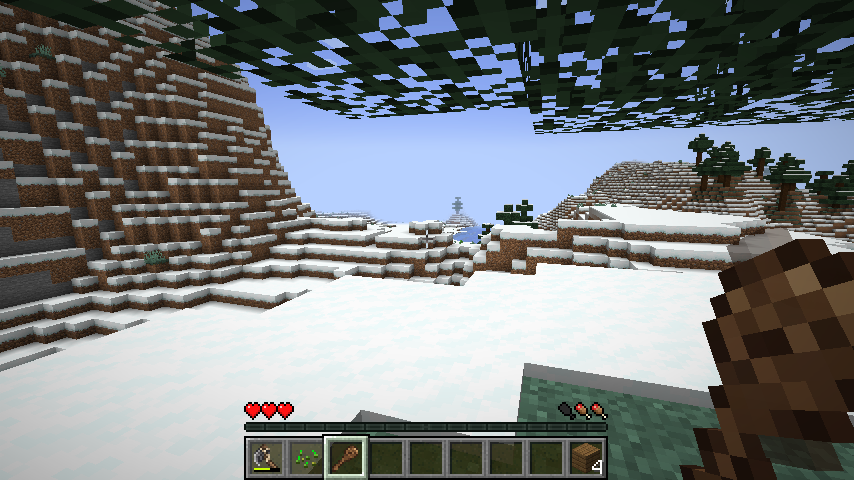
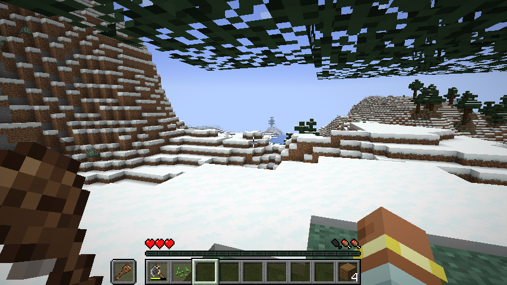
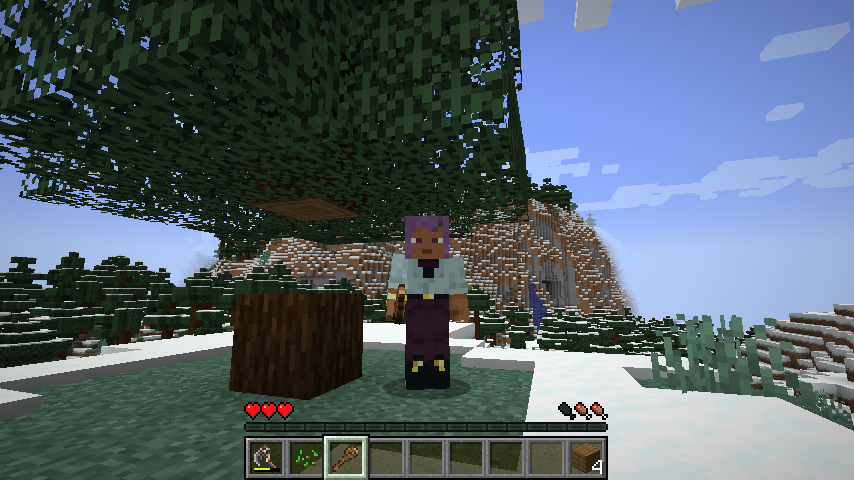
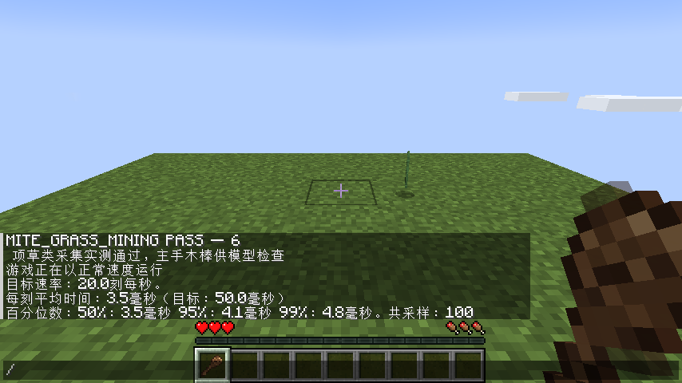

# 013 草类采集与木棒方向修复验收

开发者：NingMeng123。日期：2026-10-12。基线：`1449e6b` 加本轮工作树；草类独立证据见 [原作核对](../grass-mining-evidence.md) 与 [结构化规格](../../spec/r196-grass-mining.json)。

## 修复范围

新版短草、蕨、枯灌木、高草、大型蕨原始注册硬度为零；之前直接进入通用公式的零硬度瞬破分支。现在只在采集计算中映射有效硬度 0.02，并把原版铁剪刀对这五种植物的基础强度设为 8。空手/木棒 0 级有能量时每次进度 `0x3dc80000`，需要 11 次有效累加；铁剪刀仍走瞬破分支。草方块不是草植物，继续使用此前的有效硬度 0.5。现代双格植物为明确适配，其他工具继续保留当前现代速度，掉落与剪刀耐久也保留现代规则。

木棒 PNG 的棒头在左上、柄在右下，与默认 handheld 变换所需的斜向相反。修改模型的显示变换，将局部几何顺时针旋转 90°；保留第一/第三人称原有平移与缩放，左手考虑引擎的 Y/Z 符号翻转。物品栏、掉落和展示框同步调整。PNG 文件未改，沿用新绘材质。物品栏现在柄在左下、棒头在右上，第一人称手持向上直立。

## 自动测试

21:05:04 首次 `build runGameTestServer` 成功，150 项 JUnit、72 组 GameTest 全通过。本轮新增 5 组 GameTest，覆盖：

- 五种植物、双格上下半部的局部硬度；空手与木棒的精确进度；注册硬度不变；草方块、花、蘑菇、火把回归。
- 0/35/−40 等级与食物有/无/恢复的独立 float 位型及累加次数。
- 原版剪刀草类强度 8，并保留树叶/蜘蛛网 15、羊毛 5、藤蔓/地衣 2；其他现代工具速度不被替换。
- 一次读取挖掘强度、事件取消及非正速度保护。
- 真实服务端 START 与过早 STOP 不会立即破坏空手草；延迟完成后正常移除。双格任一半破坏均清除整株；剪刀可即时破坏，单株/双株保持现代掉落及一次耐久消耗。

审查发现“剪刀 −40 级且食物 0”的组合尚无直接断言，已补入 `0x3d000003`、32 次累加。**21:12:47 重新运行全部 72 组 GameTest，通过**。这次只追加测试断言，生产代码与先前实机版本相同。

## 实际客户端

没有使用原存档做破坏性测试。先确认 `run/saves/新的世界` 未被游戏锁定，将其复制为 `MITE Grass Mining Test-013`，所有命令和测试器都在该副本中执行。测试器必须显式启用，并逐次核对精确目录、玩家 UUID；场地、植物与工具由测试器提供。

第一次打开客户端检查模型：21:06:07 记录右手、21:07:17 记录左副手；随后 F5 检查第三人称左右手握持，21:08:40 记录正面第三人称。物品栏方向与用户给出的参考一致。第一轮正常保存退出。







第二次打开客户端启用草类验收，通过正常持续攻击键、自然选框射线和正常挖掘包运行；不直接调用服务端破坏函数。每 tick 检查焦点、落地、食物、主手及进度位型；服务端逐案确认方块清除与损伤。

| 完成时间 | 0级场景 | 基准有效累加 | 实际客户端 tick | 结果 |
| --- | --- | ---: | ---: | --- |
| 21:10:12.397 | 有食物，空手短草 | 11 | 12 | 正常破坏 |
| 21:10:13.535 | 有食物，木棒短草 | 11 | 17 | 正常破坏，木棒损伤 0 |
| 21:10:14.688 | 有食物，空手蕨 | 11 | 17 | 正常破坏 |
| 21:10:15.902 | 有食物，空手高草上半部 | 11 | 17 | 上下半部均为空气 |
| 21:10:19.090 | 食物0，空手短草 | 52 | 58 | 持续采集后破坏 |
| 21:10:19.700 | 有食物，铁剪刀短草 | 瞬破 | 6 | 掉落1短草，剪刀损伤1 |

实际计数包含首次输入与连挖冷却，所以不等于纯有效累加。11 次对应 20 TPS 下理论累加时间 0.55 秒，不承诺每次按键到完成都是精确 0.55 秒。剪刀本身进入瞬破分支，但上一块后的连挖冷却仍需等待。

**21:10:19.735** 取得 `MITE_GRASS_MINING PASS`，计数 `[12,17,17,17,58,6]`，整轮 228 客户端 tick。21:11:16.180 `/tick query` 确认 20.0 TPS、平均 3.5 ms/tick；全程未加速。



21:14:11.993 所有维度保存完成；21:14:38 正常退出，`runClient` 返回 `BUILD SUCCESSFUL`、退出码 0。本轮草类客户端日志无 ERROR 或 Exception。

## 构建与边界

```powershell
.\gradlew.bat build runGameTestServer --console=plain
.\gradlew.bat runClient '-PmiteTestWorld=MITE Grass Mining Test-013' -PmiteGrassMiningSmoke=true --console=plain
```

JAR `build/libs/mite-0.1.0.jar` 共 153 个条目，不含 GameTest、客户端测试器或参考源码。SHA-256：`2518faf564fe48a32f7efe2d369c9f03ed10925b39ca7c6bfea19068f0de2802`。

未扩大为全植物或全工具复刻；旧右键剪取、旧植物掉落、镰刀、Witherwood 与全局 portable 下限未实现。实际客户端覆盖上述六例，枯灌木/大型蕨及更多食物等级组合由 GameTest 覆盖；未新增双客户端联机测试。掉落/展示框方向只做模型配置核验，没有专项实机截图。

中文提交说明：`修正木棒握持方向并还原R196草类采集速度`。
