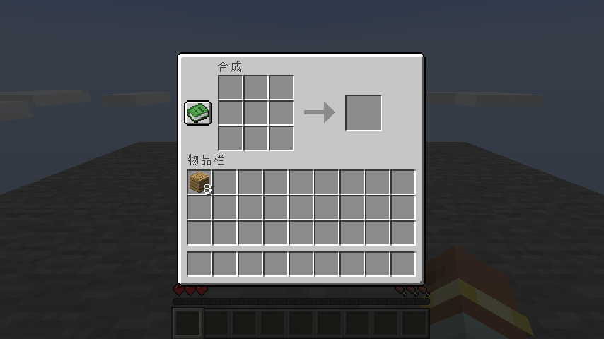
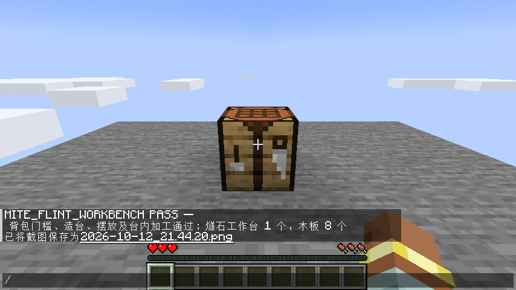

# 014 燧石工作台与木板加工验收

开发者：NingMeng123。日期：2026-10-12。基线：`9d4d460` 加本轮工作树。规则来源与现代适配边界见 [燧石工作台适配](../flint-workbench-adaptation.md) 和 [结构化规格](../../spec/r196-flint-workbench.json)。

## 功能

沿用 `minecraft:crafting_table` 注册 ID 和新版工作台材质，中文物品名改为“燧石工作台”。固定 2×2 配方上排“燧石、线或筋”，下排“木棍、原木”；可水平镜像和在 3×3 中平移。替换原四木板配方，原木材料按现代 LOGS 标签扩展。

背包 2×2 不再允许加工 PLANKS 标签的木板结果。共用服务端结果计算在组装后、同步前过滤输出；普通取出与直接快捷转移均在物品移出前重新检查。判定使用物理网格，避免把工作台内一格原木裁剪为 1×1 后误封。普通工作台和自动合成器保留木板配方与产量：常规原木 4 板，竹块 2 板。原木与竹块 tooltip 提示需要工作台或自动合成器。

## 自动验证

`runData` 成功生成覆盖原版 ID 的工作台配方及对应配方书进度。21:46:46 首次 `build runGameTestServer` 退出码 0；150 项 JUnit 和全部 78 组 GameTest 通过。本轮新增 6 组：

- 线/筋各 24 种材料排列，仅固定图案及水平镜像合法；3×3 平移、旧四板配方、错误材料与额外材料检查。
- 实际背包菜单普通点击和 Shift 取出工作台，逐项检查消耗与重复取出；物理网格尺寸边界。
- 11 种木板配方在背包四个输入位置均无输出；人为注入旧结果后，PICKUP、QUICK_MOVE、SWAP、THROW、直接 quickMoveStack 和 safeTake 均不能取走结果或消耗材料。
- 配方书普通放入及全部放入会移动材料，但不能生成背包木板；关闭后完整退回。
- 实际 3×3 工作台对 11 种配方的普通/快捷加工均保留产量，并验证配方书批量三原木产 12 板。
- 两台自动合成器接受真实红石脉冲，分别把一原木加工成 4 木板、一去皮竹块加工成 2 竹板并送入相邻箱子；各只消耗一个输入。

审查后补入竹块/去皮竹块不能替代工作台原木材料、3×3 平移的镜像、绑定材料移到图案外的拒绝断言。21:48:26 重新运行全部 78 组 GameTest，通过；仅测试新增断言，生产代码与已通过的实机版本一致。

## 游戏实测

确认原存档未被占用后，将其复制为 `MITE Flint Workbench Test-014`。测试器仅在显式属性开启、目录精确匹配且玩家 UUID 一致时工作。测试准备在副本中建立平台并提供 2 原木、4 木板、1 燧石、1 线、1 木棍；不把提供材料视为完整开局获取验证。

打开真实开发客户端，测试器通过正常客户端菜单点击与交互包完成操作；摆放和打开工作台使用实际准星选中的方块。逐步核对客户端与集成服务端的网格、光标、背包和掉落实体。

| 时间 | 操作与结果 |
| --- | --- |
| 21:43:53–54 | 背包放入单原木，双端无输出；点击结果槽不消耗材料，回收后物资数量不变 |
| 21:43:56–57 | 四木板旧配方无输出；材料全量回收 |
| 21:43:59 | 背包按新配方快捷制造一张台，双端各消耗一套材料，中文名“燧石工作台” |
| 21:44:00 | 热键选中台，正常右键地面摆放，台物品消耗一次且方块存在 |
| 21:44:02 | 正常右键打开 3×3，剩余一原木经一次 Shift 取出 4 木板 |

21:44:02.314 收到 `MITE_FLINT_WORKBENCH PASS`，全程 289 客户端 tick。最终两端均为 8 木板、1 个已放置工作台、0 原木/燧石/线/木棍/工作台物品；光标及网格为空，场地区域多余掉落为 0。





21:45:39.353 所有维度保存完成，21:45:49 正常退出，`runClient` 返回成功和退出码 0。该客户端运行日志无 ERROR 或 Exception。未执行加速；本轮不涉及采集耗时比较。

```powershell
.\gradlew.bat runData --console=plain
.\gradlew.bat build runGameTestServer --console=plain
.\gradlew.bat runClient '-PmiteTestWorld=MITE Flint Workbench Test-014' -PmiteFlintWorkbenchSmoke=true --console=plain
```

发布 JAR：`build/libs/mite-0.1.0.jar`，162 个条目，无 GameTest、客户端测试器或参考源码。SHA-256：`ae2d3ff71aafc732cba4f9898a9160388b22f237bbb60069394c1a786c747c43`。

## 明确边界

没有新增方块纹理，仍使用现代原版外观。没有实现燧石刀替代配方、拆台返还原木、高级金属台、旧木种台变体、制造时间、经验或品质。现代已有工作台及结构来源仍可使用；不宣称燧石是唯一进度入口。

实际客户端覆盖橡木与线的主流程；筋、镜像、其他木种、竹块、配方书和自动合成由服务端 GameTest 覆盖。tooltip 文案与客户端类加载经过资源/启动检查，未单独截图验收。未补做重进或双真实客户端联机；第三方自定义容器尚未承诺兼容。

中文提交说明：`复刻燧石工作台并限制背包加工木板`。
