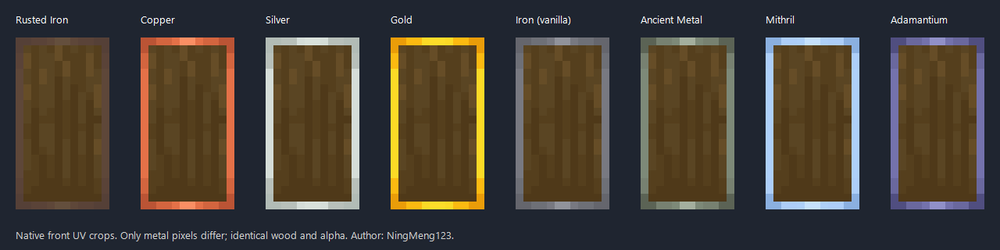

# 金属盾与怪物格挡验收

作者：NingMeng123

原版 `minecraft:shield` 保留物品 ID，作为铁盾。所有盾牌的默认耐久为调整前的 2 倍，锈铁盾以外的最高品质耐久为调整前的 1.5 倍。盾牌的基础耐久翻倍。普通及以下品质沿用原品质倍率，高于普通的品质在原倍率上再乘 0.75。锈铁盾的基础耐久为 168，品质上限为劣质，默认耐久与最高耐久均为 126。其余盾牌的默认耐久等于基础耐久。

| 盾牌 | 默认耐久 | 品质上限 | 最高品质耐久 |
| --- | ---: | --- | ---: |
| 锈铁 | 126 | 劣质 | 126 |
| 铜 | 168 | 优秀 | 252 |
| 银 | 168 | 优秀 | 252 |
| 金 | 168 | 精良 | 315 |
| 铁 | 336 | 大师 | 756 |
| 远古金属 | 672 | 大师 | 1512 |
| 秘银 | 2688 | 传奇 | 7056 |
| 艾德曼 | 10752 | 传奇 | 28224 |
| 振金 | 21504 | 传奇 | 56448 |

盾牌保留原生 5 tick 举盾前摇、正面判定、绕背及穿透/绕过盾牌的伤害类型规则。成功格挡且耐久损伤预算不少于 3 时，损耗为 `1 + floor(预算)`，玩家使用原生盾损耗路径，怪物补齐原生空实现。MITE 耐久附魔、装备腐蚀诅咒、破碎通知继续经过同一 ItemStack 损耗流程。耐久 V 可用于这些盾，锈铁的自然可附魔性为 0。MITE 斧、战斧、短柄斧同原版斧一样可以打断玩家和怪物的格挡。

兼容修正：NeoForge 21.1.259 的 `LivingShieldBlockEvent` 文档规定取消后应按未格挡处理，但原生 `getBlocked()` 没有读取取消标记。本次在原生伤害流程收到事件后应用该取消状态，玩家和怪物都继续正常承受伤害且不扣盾耐久；单独调整耐久预算仍保留原生语义。

累计格挡破盾按材质分档。基础档铜、银、锈铁、金为 5 次或 50 点，铁和远古金属为 10 次或 90 点，秘银为 15 次或 162 点，艾德曼为 20 次或 291.6 点，振金为 25 次或 524.88 点。未知第三方材质按基础档处理。伤害上限保留小数，每次格挡读取实际接受的伤害，任一上限达到即破盾。材质档位独立于物品经验等级和品质；2026-10-22 装备经验统一减半后，未安装ITE时的格挡入账经验为实际伤害的1倍，原始2倍计算只作为减半前输入。物品提示不显示负荷。version 1保存字段保持兼容，合法状态范围扩大至最高材质档；玩家、怪物、主副手及修理继续使用同一累计记录。

玩家和持盾怪物的斧击破盾、累计格挡破盾均按破盾时所用盾牌的材质计时。锈铁、铜、银、金及未知第三方材质为 110 tick，原版铁盾为 100 tick，远古金属为 90 tick，秘银为 80 tick，艾德曼为 60 tick，振金为 30 tick。同一实体的盾牌共享冷却，期间换盾仍需等到冷却结束。

除锈铁外，新增金属盾按 6 木板与 1 对应金属锭合成；铁盾保留原版配方。锈铁没有金属锭物品，来源为怪物装备掉落与创造栏。制造受同等级金属工作台、计时和品质选择约束；现代适配难度为 `6 × 80 + 金属耐久系数 × 100`。修理使用对应金属粒及足够等级的铁砧，完整修复按一个金属构件计算。合并修理要求同品质、相同旗帜纹饰，不额外赠送 5% 耐久。贴旗帜保留原盾的品质、损伤和自定义名字，不再次收取制造品质经验；自动合成器同样保留这些数据。

适用僵尸、骷髅、猪灵和卫道士在新生成时有 15% 概率装备剑盾组合。已有近战武器时盾材质跟随武器，空手时按第 30 天铜级、第 90 天铁级提升，之前为锈铁。已有副手、弓、弩等装备不被覆盖；存档加载或跨维度不会重新抽取。持盾怪只对近距离可见的生存玩家尝试举盾，初次反应至少 10 tick，18–30 tick 持盾，随后 24–40 tick 反击空窗。举盾期间不能同时近战攻击；移动和看向目标继续使用已有 AI。

贴图位于 `src/main/resources/assets/mite/textures/entity/shield/`。使用内置 imagegen 编辑原版 `shield_base_nopattern.png` 的放大参考图，七种材质分别参考已有金属物品色板。生产归一化锁定原版 UV、透明度、木板及所有非金属像素，只应用生成结果的金属边缘颜色。每个成品保持原版 64×64 像素布局，模型和旗帜叠加复用原生盾牌几何。

图中是贴图裁切预览，并非游戏画面。生产脚本 `tools/assets/normalize_shield_textures.ps1` 保留原始灰阶排列，机器报告确认每张只修改 284 个金属像素，3780 个非金属像素、全部 4096 个透明度值及 32 个原始黑色 UV 像素原样保留。

生成提示词（每种材质独立调用，内置工具模式）：

> Use case: precise-object-edit. Asset: production Minecraft shield UV pixel texture. Image 1 is the edit target, an exact 8x nearest-neighbor enlargement of a 64x64 shield UV atlas; image 2 is only the metal palette reference. Change ONLY the grey iron-metal rim/edge pixels and grey handle metal on image 1 to [material palette]. Keep the wooden planks, woodgrain, all UV island placement, shape, silhouettes, holes, outlines, empty areas and alpha exactly unchanged. Preserve the existing coarse pixel artwork, original shading pattern and visible square 8x8 pixel grid; no smooth rendering, antialiasing, text, objects, shadows, glow, border or background. Do not paint the wooden centers or make a shield illustration. Return the same full square UV atlas, transparent background, no cropping, exact original composition. This is a conservative metal edge recolour of the existing pixel texture, not a redesign.

材质提示补充：锈铁使用暗铁灰与克制的橙褐锈斑；铜使用铜锭橙色；银使用银锭淡银白色；金使用金锭暖黄色；远古金属使用淡绿灰；秘银使用冰蓝；艾德曼使用低饱和蓝紫。图像生成的原始结果保留于 Codex generated_images，项目消费的是上述仓库内归一化 PNG。

自动验收入口：

首次接入验证通过：1496 项 JUnit、1716 项 GameTest、盾牌客户端变换审计及原有骷髅武器显示审计。已验证分发包包含全部 7 张纹理、14 个模型、6 个新增配方和所需客户端/服务端 Mixin，且不包含 GameTest 类。

二分之一耐久调整验证通过：1496 项 JUnit、1716 项 GameTest，涵盖八种盾牌实际最大耐久、品质、修理、破损、装饰及怪物格挡。当前分发包为 `build/libs/mite-0.1.0-shields-half.jar`，SHA-256 为 `474712265c7d7f8eea6885ab46f0cd1df097de70e87301f7cb5f047bc35bcf4d`。

2026-10-18材质破盾分档验证：独立快照构建、1593项JUnit、55项成长专项及1951项服务端GameTest全部通过。覆盖九种盾牌、玩家和怪物、主副手、精确伤害边界、高阶负荷保存与修理以及100tick冷却。怪物的旧固定25点/3次重复分支已移除，原有怪物盾磨损和斧头打断继续生效。分发包为`build/libs/mite-0.1.0-material-shield-guard.jar`，验证记录见`build/verification/shield-material-build-tests-final.log`和`build/verification/shield-material-server-regression.log`。

- `ShieldDurabilityRulesTest`：基准、材质比例、品质倍率及非法配置。
- `ShieldGuardRulesTest` / `ShieldGuardGameTests`：各材质的累计次数与伤害边界、原版铁盾映射、旧版及高阶负荷保存、修理、终止格挡和按材质分档的共享冷却。
- `ShieldEquipmentGameTests` / `ShieldCraftingIntegrationGameTests`：物品、同步、修理、制造、旗帜和附魔。
- `ShieldAssetsGameTests`：真实配方、装饰与标签。
- `MobShieldGameTests` / `ShieldBlockDurabilityGameTests`：新生装备、保存/加载、方向、前摇、空窗、真实伤害与耐久事件、盾破损和斧破盾。
- `runData -PmiteShieldAudit=true`：实际变换后的客户端模型、原生装饰与 renderer/predicate 接入。报告 `build/verification/shield-client-audit.json`；它不创建游戏世界或执行画面渲染。

手工游戏内检查：依次观察八种盾的物品栏、第一/第三人称和怪物持盾外观；木纹不变，仅金属颜色改变。对持盾怪尝试正面连续攻击、绕后攻击和斧击，确认举盾、反击与破盾冷却；给盾贴旗帜，检查品质、耐久、名字和边框仍正确。
