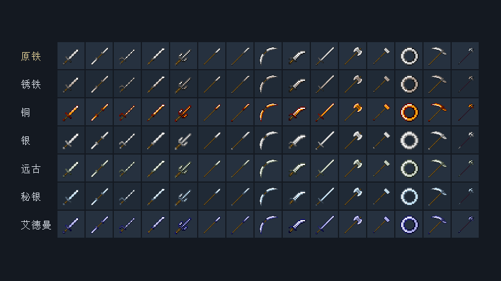

# 简易刀剑兼容验证

日期：2026-10-17。开发与验证：NingMeng123。

2026-10-17 用户确认本批交付“没有问题”，并授权提交、推送 GitHub；未另行提供具体手测或联机步骤记录。

环境：Java 21、Minecraft 1.21.1、NeoForge 21.1.259、Simply Swords NeoForge 1.70.2-1.21.1。使用用户提供的 Simply Swords JAR；仅在隔离测试目录安装其 Architectury、Fzzy Config、Kotlin for Forge 依赖，客户端另安装 Simply Tooltips。

## 结果

| 验证 | 结果 |
| --- | --- |
| `gradlew build` | 成功，1528 项 JUnit 测试，无失败 |
| 双模组服务端兼容测试 | 17 项全部通过 |
| 未安装 Simply Swords 的完整服务端回归 | 1860 项全部通过，包含兼容缺失分支 |
| 资源生成器 `--check` | 90 武器、75 配方、75 配方解锁及 485 个资源文件一致 |
| 独立 Python 资源审核 | 原透明轮廓及非金属区域保持、材质区别、配方条件、标签与动作父级均通过 |
| 双模组开发客户端模型审核 | 90 个真实烘焙模型与物品缓存、atlas sprite、三维巨锤、原图尺寸与透明轮廓、每族六种材质区别全部通过 |
| 未安装 Simply Swords 的客户端审核 | 通过，新增武器为 0、被请求的可选模型为 0，无缺失贴图引用 |
| 发布包审核 | 90 模型、90 PNG、75 配方、可选依赖与投掷 Mixin 齐全；无 GameTest 类或 Simply Swords 外部代码 |

客户端测试从真实 `ItemRenderer` 渲染原铁与六套新增材质，至少绘制两帧后截取实际帧缓冲。预览为 `build/reports/simplyswords-in-game.png`，第一行是原铁，后续依次为锈铁、铜、银、远古金属、秘银、艾德曼。巨锤使用实际三维物品模型。

## 覆盖

- 90 个新增身份、原生金复用、105 个材质与武器族组合的基础耐久、全部品质上限及倍率、物品保存和网络传输。
- 原有剑类武器全部纳入，包括符文、独特武器和木制玩具；非武器材料不纳入装备。
- 15 类武器真实 `ItemStack` 回调保留原打击音效，每次只扣一份 MITE 耐久；符文浮空被动仍能实际给予悬浮效果。
- 对应金属粒维修、品质保留、铁砧承载能力、工作台门槛、75 条实际配方匹配与组装、锈铁仅作战利品、创造分类和附魔标签。
- 首次 tick 见到最终装备后才进行 15% 抽取，保留材质、品质、附魔、损耗比例与掉率；读档不重抽，弓及专用装备受保护，无扩展时不消耗随机数。
- 原投掷矛批准命中后扣损 50，原生回收与 NBT 保留同一武器；拒伤和重复命中不重复扣损，创造模式免损，破损矛消失。

## 调整与边界

外观按用户提供的原模组截图重做，最终版本保留原模组每类武器的轮廓、像素结构、握柄和装饰，只在原金属区域绘制 MITE 材质。旧的自行设计武器轮廓未用于交付。原环刃含半透明像素，因此客户端验证逐像素保持原 alpha，而不强制更改为二值 alpha。

集成检查发现并修复默认 `ItemLore.EMPTY` 被误当作自定义 Lore、导致持械怪物无法替换的问题。投掷兼容还同步了原投射物的显示栈、拾取栈和存档栈，防止磨损在回收或读档时丢失。

Simply Swords 自带的 `mythicmetals_compat/adamantite/adamantite_twinblade` 和 `eldritch_end/dreadtide` 配方在缺少对应第三方模组时输出原包配方解析错误；本次未修改这些不属于 MITE 的配方。新增 75 条 MITE 配方均实际加载并通过匹配验证。

运行记录均在被忽略的 `build/verification` 中，包括 `simplyswords-present-verified.log`、`simplyswords-absent-full.log`、`simplyswords-client-verified.log`、客户端 JSON 和发布包审核 JSON。自动验证已启动独立服务端及开发客户端；用户确认状态见本文开头。

## 测试包

`build/releases/mite-0.1.0-simplyswords.jar`

SHA-256：`8adeaa922019d5aa207750cc8b271cd723aeb9d02d4f81e224dbe6558be1e690`。

## 2026-10-18 双手武器负重

开发与验证：NingMeng123。主手双手武器额外降低 20% 攻速、15% 移速，按原有最终属性乘算。Better Combat 存在时使用其真实武器注册表及动作预设；缺失时使用源资源生成的双手标签（299 个可选条目，含 56 把新增金属武器）。

| 验证 | 结果 |
| --- | --- |
| `gradlew build` | 成功，1594 项 JUnit 测试，无失败或跳过 |
| 仅安装 Simply Swords 的服务端 GameTest | 23 项全部通过 |
| Simply Swords 与 Better Combat 同时安装的服务端 GameTest | 23 项全部通过 |
| 未安装 Simply Swords 的服务端 GameTest | 23 项全部通过 |
| 资源生成器 `--check`、独立资源审核及实际模组 JAR 对照 | 通过，双手标签与上游属性继承、显式单手覆盖及镰刀后备动作一致 |
| 发布包审核 | 包含处理类及双手标签，标签与源文件一致，不含 GameTest 类 |

新增 5 项 `SimplySwordsHandlingGameTests` 实际验证 12 套材质与 15 族、独特武器特例、各装备槽、重复读取及保存重载；通过真实玩家装备 tick 检查攻速与移速下降、原伤害保留、切换双手武器不叠加、单手/空手恢复、副手不触发。Better Combat 分支还检查注册表一致、双向动作预设覆盖和同一武器基础属性下怪物实际攻击间隔延长。

日志位于被忽略的 `build/verification/simplyswords-handling-{build,present,absent,bettercombat}.log`。本次构建产物为 `build/libs/mite-0.1.10.jar`。
