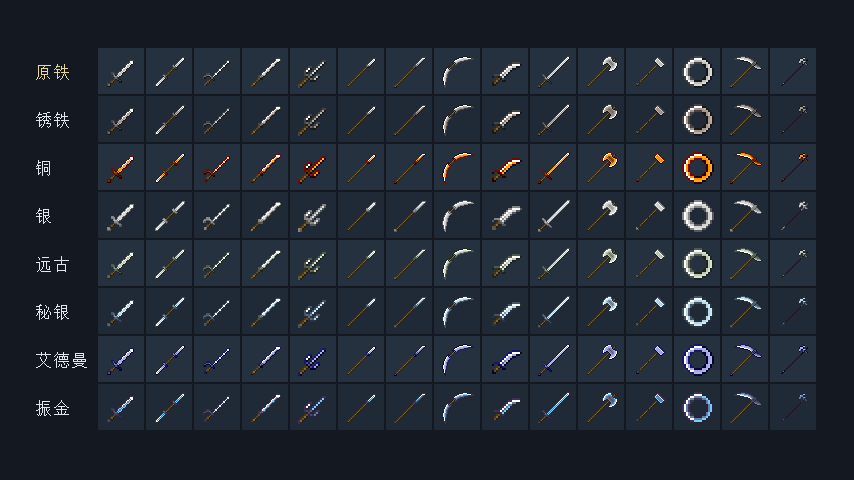

# 振金装备验收

日期：2026-10-18。开发与验证：NingMeng123。

新增 19 件原生装备（13 类工具近战武器、4 件盔甲、盾牌和弓）与 15 件可选简易刀剑，另有振金锭、振金粒、黑曜石棒、振金工作台、振金锻造桌和振金块。简易刀剑需要用户安装 Simply Swords 及其依赖；不安装时原生装备仍可使用。

来源数值、破晓网页与附件版本的差异，以及明确的现代适配见 [振金来源](../vibranium-source.md)。普通品质耐久采用本项目的材料系数与逐次磨损精度；并未套用破晓页面的 407/592/555/481 耐久。原生配方采用 Extreme 与基础模组的装备升级路线。新增剪刀、盾牌和简易刀剑的 [贴图制作记录](../art/vibranium-textures.md) 包含内置 ImageGen 的完整提示词及规范化过程。

## 生存取得与手测

1. 在艾德曼工作台放入 `NIN / IDI / NIN`：N 为秘银粒，I 为艾德曼锭，D 为钻石，取得首块振金。按现有金属工作台形状，以振金锭、皮革、木棍和木板制作振金工作台；同样在艾德曼台完成这一步。
2. 振金台上可升级原有装备。盔甲使用对应艾德曼装备和 4/7/6/3 个振金锭；剑与镐也升级艾德曼装备，其他原生升级以远古金属装备为底。黑曜石棒由上下两个黑曜石制造。完整形状见来源文档，安装 JEI 时可查看配方。
3. 给底材装备命名、附魔并制造损耗，再升级。产物应保留名称、附魔和品质，损耗按新旧耐久上限同比例换算；攻击、护甲、韧性、采掘等级和防火属性使用新装备数据。
4. 补全的短斧、小刀、锄、鹤嘴锄、镰刀、剪刀、盾牌，以及 15 类简易刀剑可在振金工作台直接制造。制造仍有耗时和品质经验要求；低级台和背包不能越过振金门槛。
5. 九粒合一锭、一锭拆九粒，九锭合一块；拆块产出的九锭按本项目八堆叠上限搬运。锻造桌使用三个振金块和四个振金锭制造，共 31 锭。
6. 在振金锻造桌用振金粒维修各件装备，品质保持。艾德曼锻造桌承载不足；振金锭不能替代维修粒。锻造桌耗损、拆下后的耗损保存，以及 JEI 维修展示沿用统一流程。
7. 穿齐护甲，基础盔甲总值为 24、总韧性为 16、现代击退抗性为 0.6。确认物品图标、动画、穿戴两层纹理、弓的拉弓动画与盾牌持握均正常；振金弓满蓄力弹速增加 75%。
8. 检查新生成怪物的日期成长，再安装 Simply Swords 检查 MITE 战斗页中的 15 把振金武器，包括巨锤三维 UV、投掷长矛的拾回品质/损耗，以及 Better Combat 动作。将物品丢入火或岩浆应保持，怪物装备将振金排在艾德曼之后，普通日按最高日期连续提高振金概率，血月继续按原阶段规则推进；已有怪物不重新抽取装备。
9. 普通附魔台四周隔一格摆四层书架（与台面方块同高至高三格，每层计入 12 个非角落书架），保持传能间隙与台上方畅通。振金装备最高选项应为 158 能量，消耗 15800 经验点和 3 个青金石；绿宝石台对应 98 能量、9800 经验点。默认可获得耐久 V、锋利 VII。

## 自动验证

JUnit、服务端 GameTest、客户端模型审核和逐图资源审计分别记录，不将客户端物品渲染等同于护甲穿戴人工验收。原始日志保存在被忽略的 `build/verification/vibranium-*` 中。


| 验证 | 结果 |
| --- | --- |
| 构建与 JUnit | 完整构建成功，1541 项通过，无失败、错误或跳过 |
| 安装 Simply Swords 的服务端集成 | 47 项全部通过，包含实际工作台升级、维修、投掷、生成与回收 |
| 未安装 Simply Swords 的全量服务端回归 | 1955 项全部通过，含怪物成长、特殊装备家族与锻造桌精度边界 |
| 安装 Simply Swords 的实际客户端审核 | 24 个原生振金模型、105 个兼容武器模型通过，实际 ItemRenderer 截图完成 |
| 未安装 Simply Swords 的实际客户端审核 | 24 个原生振金模型通过，可选武器为 0 |
| 资源与再生成检查 | 109 个固定上游文件、64 张 PNG、46 份动画元数据、61 个原生模型引用、105 张兼容贴图与 90 条可选配方通过；旧 90 张兼容贴图字节未变 |
| 发布 JAR 审计 | 1195 个生产类与当前编译输出逐字节一致，3029 份 JSON 可解析，69 个振金关键资源齐全；署名为 NingMeng123，未混入 GameTest 或上游源码类 |

两个客户端均在独立目录启动并正常退出，未创建世界。原生审核包含盔甲层资源可读取及尺寸正确；实际穿戴动作、第一人称持握和真实双客户端联机仍需人工验收。

最终全量命令为 `.\gradlew.bat runGameTestServer build -PmiteGameTestDirectory=build/verification/vibranium-acceptance-20261018 --console=plain`。日志 `build/verification/vibranium-acceptance-20261018.log` 于北京时间 02:19:17 确认全部 1955 项通过，构建进程退出码为 0；安装 Simply Swords 的 47 项通过证据在 `build/verification/vibranium-present-verified.log`。

锻造桌阶段推断保留来源版本的单精度比较：振金总耐久 25,395,200，损耗 20,316,159 时已达到 `0.8F` 损坏阶段，故缺少精确损耗组件的阶段 2 物品估算剩余 5,079,041。测试使用独立阈值字面量，并覆盖阈值前后一点、非整除容量和 `Integer.MAX_VALUE`，不以精确整数八成代替来源判定。



本地测试包：`build/releases/mite-0.1.0-vibranium.jar`，8,726,027 字节。SHA-256：`9ea4eaa8eb1d444064e1bc80749f7d91bbd9af275ba0525d8c213ecbd1592323`。审核报告为 `build/verification/vibranium-release-audit.json`；构建产物和原始验证日志不提交 Git。

可复现检查：

```powershell
python tools/assets/import_vibranium_assets.py --verify
python tools/assets/generate_vibranium_recipes.py --check
python tools/testing/verify_vibranium_resources.py
python tools/assets/generate_simplyswords_compat.py "run/mods/[简易刀剑] simplyswords-neoforge-1.70.2-1.21.1.jar" --check
python tools/testing/verify_simplyswords_resources.py "run/mods/[简易刀剑] simplyswords-neoforge-1.70.2-1.21.1.jar"
.\gradlew.bat build
```
